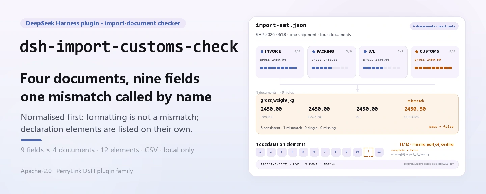

<div align="center">

<picture>
  <source media="(prefers-color-scheme: dark)" srcset="docs/assets/dsh-import-customs-check-hero-en-dark.webp">
  
</picture>

# dsh-import-customs-check

**Cross-check the four import documents field by field, then list the customs declaration's missing 12 elements.**

A local-only import-document checker for DeepSeek Harness: read one prepared JSON, cross-check 9 header fields, inspect the declaration's 12 header elements, and export CSV when you need a record — no network, no model call, no upload.

[Install](#three-step-setup) · [Configuration](#configuration) · [FAQ](#faq) · [简体中文](README.md) · [English](README.en.md) · [Español](README.es.md) · [Português](README.pt.md) · [हिन्दी](README.hi.md)

[](LICENSE)
[](#compatibility)
[](https://www.npmjs.com/package/dsh-import-customs-check)
[](https://github.com/PerryLink/dsh-import-customs-check/actions/workflows/ci.yml)
[](#compatibility)

[](https://github.com/PerryLink/dsh-import-customs-check/stargazers)
[](https://www.npmjs.com/package/dsh-import-customs-check)

```sh
dsh plugin --profile <profile> add dsh-import-customs-check
```

</div>

<sub>Community plugin, not affiliated with DeepSeek. Canonical repository: <https://github.com/PerryLink/dsh-import-customs-check>.</sub>

<sub>Status: alpha / public-synthetic / partial / not counted / not GA — no real customs declaration, customer data or customer evidence; no compliance, classification or filing conclusion.</sub>

## What it is

In one sentence: read one import shipment's four-document JSON (invoice, packing list, bill of lading, customs declaration), compare 9 header fields into a per-field table of consistent / mismatch / single-source / not-provided, then check the declaration against the 12-header-element list and export the field table as CSV when you need a record.

- **Fits:** one import shipment whose invoice, packing list, bill of lading and customs declaration are already available as JSON; a pre-filing check of invoice no, contract no, packages, gross/net weight, amount, currency, HS code and origin country; confirming that all 12 declaration header elements were filled.
- **Does not fit:** PDFs, scans, images or Excel as direct input (no OCR here; prepare JSON first); line-item SKU/quantity/unit-price matching; classification rulings, origin rules, customs value or licence decisions; replacing a broker, customs authority or lawyer; multiple shipments in one file.

<picture>
  <source media="(prefers-color-scheme: dark)" srcset="docs/assets/dsh-import-customs-check-flow-v5-dark.svg">
  
</picture>

## Three-step setup

1. **Install** (pick one channel):

   ```sh
   # npm channel (recommended; published release)
   dsh plugin --profile <profile> add dsh-import-customs-check
   # git channel (latest main; equivalent to git+https://github.com/PerryLink/dsh-import-customs-check.git)
   dsh plugin --profile <profile> add github:PerryLink/dsh-import-customs-check
   # tarball channel: pnpm pack in this repo, then
   dsh plugin --profile <profile> add ./dsh-import-customs-check-<version>.tgz
   ```

2. **Minimal config** (no Config keys at all; `cordis.patch.yml` only inserts this row):

   ```yaml
   - insert:
       - id: dsh-import-customs-check
         name: dsh-import-customs-check
   ```

3. **Verify it mounts**:

   ```sh
   dsh --profile <profile> --dump-config | grep dsh-import-customs-check
   node samples/quickstart/run.mjs --check
   ```

**Uninstall**: `dsh plugin --profile <profile> remove dsh-import-customs-check` (or remove the row from the profile patch).

## Core capabilities

Tool names are stable API; tool descriptions stay in English to match runtime output.

| Tool | Purpose | Risk |
|---|---|---|
| `import.check` | Cross-check the 9 header fields across the four documents; `strict=true` raises on mismatch | R0 |
| `import.elements` | Check the declaration's 12 mandatory header elements and list the missing ones | R0 |
| `import.export` | Write the field-check table as CSV, returning path + sha256 | R1 local write |

- **Four per-field states** — `consistent` / `mismatch` / `single_source` / `not_provided`; `summary` counts them and `pass = mismatch === 0`, so a field only one document carries is never misread as a contradiction.
- **Strict gate** — with `strict: true`, any `mismatch` raises `E_IMPORT_FIELD_MISMATCH`, ready for automation; the default mode reports without interrupting.
- **12-element completeness** — `import.elements` checks the declaration header separately and returns `{ complete, total, present, missing }`, with each missing item carrying its `key` and Chinese label.
- **Fixed normalization** — invoice/contract/origin uppercase and whitespace-collapsed, HS code stripped of dots/spaces/hyphens, weights at 0.001 kg and amounts at 0.01 half-up; no semantic mapping such as `CN` ↔ `China`.
- **Local only, read-only** — reads the JSON you name, writes only under `$DSH_HOME/dsh-import-customs-check/exports/`; no network, no model call, no upload, and the source file is never modified.
- **Errors carry a next action** — every error pairs one sentence with a stable `E_IMPORT_*` code and a next action; the exact format is shown under "Error codes".

## Input

- UTF-8 JSON for one shipment; all four documents are required:

```json
{
  "shipment_id": "SHP-2026-0618",
  "documents": {
    "invoice": { "invoice_no": "INV-2026-0618", "contract_no": "CT-2026-0042", "packages": 120,
                 "gross_weight_kg": "2450.00", "net_weight_kg": "2280.00", "amount": "184500.00",
                 "currency": "USD", "hs_code": "8471.30.00", "origin_country": "CN" },
    "packing_list": { "invoice_no": "INV-2026-0618", "packages": "120", "gross_weight_kg": "2450.00" },
    "bill_of_lading": { "invoice_no": "INV-2026-0618", "packages": "120", "gross_weight_kg": "2450.00" },
    "customs_declaration": { "declaration_no": "3101202606180001", "port_of_loading": "上海港" }
  }
}
```

- Document keys: `invoice`, `packing_list`, `bill_of_lading`, `customs_declaration`. Chinese aliases work too:

```text
商业发票 / 装箱单 / 提单 / 报关单
```

- All four are required. Fields may sit directly on the document object or under a `fields` object. English and Chinese field aliases work:

```text
invoice_no / 发票号
gross_weight_kg / 毛重
```

- Amounts and kilogram weights may be strings or JSON numbers. Comparison precision is 0.01 for amounts and 0.001 kg for weights.
- Size: up to 5 MB; read-only, the source JSON is never modified.
- Source: the local JSON the user prepared; the bundled sample is synthetic and contains no real company or declaration data.

## Output

- `import.check`: a per-field table. Each field has `status`, `compared` (number of documents that provided it), `values` (raw value, normalized value and invalid flag per document) and `note`. `summary` counts `consistent / mismatch / single_source / not_provided`, and `pass = mismatch === 0`.
- `import.elements`: completeness of the declaration's 12 header elements as `{ complete, total, present, missing: [{ key, label }] }`.
- `import.export`: writes the field table under `$DSH_HOME/dsh-import-customs-check/exports/` with one row per field and one column per document; returns path, `sha256`, bytes and rows.

| status | Meaning | Counts as failure |
|---|---|---|
| `consistent` | At least 2 documents provide the field and all normalize to the same value | No |
| `mismatch` | Normalized values differ, or a provided value is invalid | Yes (`pass=false`) |
| `single_source` | Only 1 document provides the field, so it cannot be cross-checked | No |
| `not_provided` | None of the four documents carries the field | No |

`import.check` returns the full table by default. With `strict: true`, any `mismatch` raises `E_IMPORT_FIELD_MISMATCH`, which is suitable for automated gates.

## Example

Paste this one line into the agent (the bundled prompt is Chinese):

```text
我有一套进口单证（发票、装箱单、提单、报关单），帮我核对 9 个字段是否一致，再看报关单 12 项要素缺什么。
```

Reproduce the bundled sample and compare with the golden file:

```sh
node samples/quickstart/run.mjs --check
```


The sample is one synthetic shipment. Gross weight is deliberately `2450.50` on the declaration and `2450.00` on the other three documents (a `mismatch`); the HS code is `8471.30.00` on the invoice and `84713000` on the declaration, which normalizes to the same value (formatting is not a mismatch); the declaration deliberately omits `port_of_loading` to demonstrate a missing element. `samples/quickstart/expected/result.json` is the real stdout of `node samples/quickstart/run.mjs --json`, not hand-written; the raw log is kept at [`docs/assets/quickstart.log`](docs/assets/quickstart.log).

## Configuration

This plugin has **no Config keys** — everything is tunable through the three tools' call parameters:

| Tool | Parameter | Required | Meaning |
|---|---|---|---|
| `import.check` | `path` | yes | Absolute path of the one-shipment import-set JSON |
| `import.check` | `strict` | no | `true` raises `E_IMPORT_FIELD_MISMATCH` on any `mismatch`; default `false` |
| `import.elements` | `path` | yes | Same as above |
| `import.export` | `path` | yes | Same as above |
| `import.export` | `filename` | no | Export filename, `[A-Za-z0-9._-]` only; defaults to `import-check-<first 12 chars of input_sha256>.csv` |

Call examples (tool surface):

```sh
# 1) field consistency
#    tool surface: import.check({ path: "/abs/path/import-set.json" })

# 2) strict gate (fail on mismatch)
#    tool surface: import.check({ path: "/abs/path/import-set.json", strict: true })

# 3) declaration elements
#    tool surface: import.elements({ path: "/abs/path/import-set.json" })

# 4) export the check table
#    tool surface: import.export({ path: "/abs/path/import-set.json" })
```

Tests can override the local write root with the `DSH_IMPORT_CUSTOMS_CHECK_HOME` environment variable; the default is exactly `$DSH_HOME/dsh-import-customs-check`.

## Comparison rules

| Field | Key | Normalization |
|---|---|---|
| Invoice no | `invoice_no` | Trim, collapse spaces, uppercase |
| Contract no | `contract_no` | Same |
| Packages | `packages` | Strip commas/spaces, positive integer |
| Gross weight | `gross_weight_kg` | Strip commas/spaces, 0.001 kg half-up |
| Net weight | `net_weight_kg` | Same |
| Amount | `amount` | Strip commas/spaces, 0.01 half-up |
| Currency | `currency` | 3 letters, uppercase |
| HS code | `hs_code` | Strip dots/spaces/hyphens, 6/8/10 digits |
| Origin country | `origin_country` | Trim, collapse spaces, uppercase |

## The 12 declaration elements

| # | Key | Element |
|---:|---|---|
| 1 | `declaration_no` | Declaration number |
| 2 | `declaration_date` | Declaration date |
| 3 | `domestic_consignee` | Domestic consignor/consignee |
| 4 | `overseas_consignor` | Overseas consignor/consignee |
| 5 | `transport_mode` | Transport mode |
| 6 | `transport_name` | Transport name |
| 7 | `bill_of_lading_no` | Bill of lading number |
| 8 | `supervision_mode` | Supervision mode |
| 9 | `duty_nature` | Duty nature |
| 10 | `origin_country` | Country/region of origin |
| 11 | `port_of_loading` | Port of loading |
| 12 | `domestic_destination` | Domestic destination |

These 12 are **this package's agreed header checklist**, not a statutory validation rule of a customs system or a particular port. Actual filing requirements follow the latest customs instructions.

## FAQ

<details>
<summary>What happens when a document is missing?</summary>

Both `import.check` and `import.elements` raise `E_IMPORT_DOC_MISSING`, and the detail names the gap (for example "missing: bill of lading"). The package will not guess the fourth document from three; add it and rerun. If a document truly does not apply, confirm that in the business process rather than deleting a key.

</details>

<details>
<summary>What is the difference between `mismatch` and `E_IMPORT_FIELD_MISMATCH`?</summary>

`mismatch` is a status in the result table; by default it is reported without interrupting. `E_IMPORT_FIELD_MISMATCH` is the error raised by `strict: true`. Use strict mode in automated gates and the default table for human review.

</details>

<details>
<summary>Why is a missing `port_of_loading` not a `mismatch`?</summary>

The 12-element completeness check is a separate tool (`import.elements`) and is not mixed into the nine consistency fields. A missing element sets `complete=false` and lists the missing item; it does not flip `import.check`'s `pass`.

</details>

<details>
<summary>Will different HS code formatting cause false mismatches?</summary>

No. Dots, spaces and hyphens are removed before comparison, so `8471.30.00` and `84713000` are consistent (8 digits). Six, eight and ten digits are different granularities and are reported as `mismatch`. The package does not judge whether the code itself is correct.

</details>

<details>
<summary>What precision do weights and amounts use?</summary>

Weights compare at 0.001 kg and amounts at 0.01, with half-up rounding; `2450.0006` normalizes to `2450.001` and `184500.005` to `184500.01`. This is a comparison policy, not a customs or bank valuation/settlement policy.

</details>

<details>
<summary>Does it modify or upload my file?</summary>

No. It reads the named JSON, writes only under `$DSH_HOME/dsh-import-customs-check/exports/`, and never uses the network, a model call or an upload.

</details>

## Permissions & data

Read: the import document-set JSON the user names (sample: `samples/quickstart/input/import-set.json`); nothing else.
Write: `$DSH_HOME/dsh-import-customs-check/exports/` only; the source JSON is not modified.
Network: no.
External systems: none.

`import.check` and `import.elements` are **R0** (read-only). `import.export` is **R1** (local write under `$DSH_HOME/dsh-import-customs-check/exports/`). `DSH_IMPORT_CUSTOMS_CHECK_HOME` can override the local write root for tests; the default is exactly `$DSH_HOME/dsh-import-customs-check`.

## Error codes

| Code | When | Next action |
|---|---|---|
| `E_IMPORT_DOC_MISSING` | One of the four documents is missing, JSON is malformed, a document is not an object, duplicates appear, or the file is empty/over 5 MB | Provide all four documents and check the JSON shape |
| `E_IMPORT_FIELD_MISMATCH` | `strict: true` and at least one field is `mismatch` | Read the `import.check` table, correct the document, rerun |
| `E_IMPORT_PATH_INVALID` | Input path missing / a directory / unreadable, an unwritable exports directory, or an unsafe export filename | Pass an existing JSON; export with `[A-Za-z0-9._-]` only |

The message format is:

```text
<one sentence>（E_IMPORT_XXX）｜下一步：<one action>
```

See [TROUBLESHOOTING.md](TROUBLESHOOTING.md).

## Acceptance evidence

Public/synthetic fixtures live in `samples/quickstart/`; `ACCEPTANCE.csv` records the checks. Every row is `counted=false` except the quickstart row. The full 11 rows are verified one by one by `node scripts/gate.mjs`, all `true`.

| req_id | metric | threshold | actual | pass | source | counted |
|---|---|---|---|---|---|---|
| IMP-A01 | field check | fields=9 consistent=8 mismatch=1 | fields=9 consistent=8 mismatch=1 | true | public/synthetic | false |
| IMP-A03 | gross weight mismatch | 4 sources declaration=2450.50 | 4 sources declaration=2450.50 | true | public/synthetic | false |
| IMP-A05 | 12 elements | present=11 missing=1 | present=11 missing=1 | true | public/synthetic | false |
| PS1-QS01 | quickstart golden | 1/1 | 1 | true | synthetic/quickstart | true |

*Fixture-backed rows, not a real customs run; no output is invented.*

## Security boundaries & known limitations

- **Read-only input.** The only write path is `$DSH_HOME/dsh-import-customs-check/exports/`; the source JSON is never modified.
- **No network, no model call, no upload.** The four documents, nine fields and twelve elements are parsed and compared locally; there is no remote service and no model cost.
- **Controlled export path.** The exports directory is fixed, and the filename accepts `[A-Za-z0-9._-]` only — path separators, `..`, spaces, non-ASCII and overlong names are rejected.
- **Fail closed.** Missing documents, malformed JSON, a non-object document or an unreadable path raises an `E_IMPORT_*` error; it never guesses from partial data or writes half a CSV.
- **CSV injection boundary.** Export performs RFC 4180 quoting only and does not sanitize Excel formula prefixes (cells starting with `= + - @`); do not open an untrusted CSV directly in Excel.
- **Input is prepared JSON:** no PDF, scans, images or Excel, no OCR, and no customs-declaration XML/single-window message parsing.
- Only nine header fields and 12 header elements: no line items, SKU, quantity, unit price, origin rules, classification, customs value or licence decisions.
- No semantic mapping: `CN` vs `China` and `USD` vs `US$` are different values; normalize the source.
- HS codes are checked for format and consistency only, not for correctness or applicability.
- The 12 elements are this package's header checklist, not a statutory rule; they do not replace a broker, customs authority or lawyer.
- Amount/weight comparison uses fixed half-up precision; no FX or unit conversion (for example lbs → kg).
- Local only; public/synthetic samples only; alpha/partial, not counted, no GA or production-readiness claim.

## Compatibility

| Surface | Status |
|---|---|
| Harness | `dsh >=0.2.1-rc.3 <0.4.0` |
| Node | `>=24.9.0 <25` |
| Platforms | All; local files only |
| Data | No network, no model call, no upload |

## Ecosystem & quality

- [npm package](https://www.npmjs.com/package/dsh-import-customs-check) (`0.1.0` published, with README and tarball)
- [Domain index](https://perrylink.github.io/dsh-plugins/) (PerryLink plugin catalog, includes this plugin)
- [CI workflow](https://github.com/PerryLink/dsh-import-customs-check/actions/workflows/ci.yml) (real run history for `ci.yml`)

## Related work

- [dsh-hs-candidate](https://github.com/PerryLink/dsh-hs-candidate) (HS candidates and the 12 classification elements)
- [dsh-freight-audit](https://github.com/PerryLink/dsh-freight-audit) (freight bill audit)
- [Domain index](https://perrylink.github.io/dsh-plugins/)

## Development

```sh
pnpm install --frozen-lockfile
pnpm build && pnpm lint && pnpm typecheck
node --test test/*.test.mjs
node scripts/gate.mjs
```

Current version `0.1.0`; 58 tests pass (`node --test test/*.test.mjs`). Release gate: `node scripts/gate.mjs` (metadata lint + every public acceptance row passing + all three stable error codes exercised). The README images are generated programmatically by [`scripts/gen-readme-assets.py`](scripts/gen-readme-assets.py): the hero banners with Pillow (zh / en × light / dark, four files) and the structure diagram as hand-written SVG (light and dark); safe to re-run with `python scripts/gen-readme-assets.py`. The older single-skin flow diagram stays in `docs/assets/` for external deep links, while the READMEs reference only the new hero set and the flow-v5 pair. `docs/assets/quickstart.png` is a real captured screenshot, kept together with `docs/assets/quickstart.log`.

Topics: `dsh`, `dsh-plugin`, `deepseek-harness`, `import`, `customs`, `trade-compliance`, `document-check`, `packing-list`, `bill-of-lading`, `perrylink`

## Family & thanks

This project is part of the DeepSeek Harness plugin family from [PerryLink](https://github.com/PerryLink) (all Apache-2.0). If it is useful, **a star helps the next person find it** — nothing is gated behind it.

- [@PerryLink](https://github.com/PerryLink) — creator and maintainer: the four-document parser and field normalizer, the nine-field cross-check, the 12-element check, CSV export, the quickstart golden sample and the five-language docs.

## License

[LICENSE](LICENSE) (Apache License 2.0) © 2026 dsh-import-customs-check contributors. See also `NOTICE` and `THIRD-PARTY-NOTICES`.

<p align="center"><sub>Apache-2.0 · Community plugin, not affiliated with DeepSeek.</sub></p>
