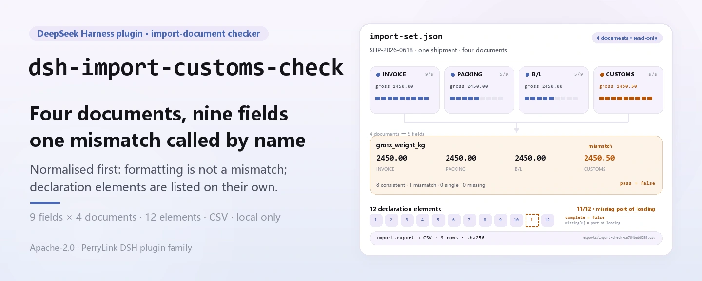
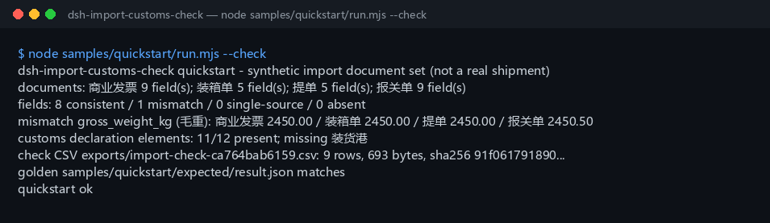

<div align="center">

<picture>
  <source media="(prefers-color-scheme: dark)" srcset="docs/assets/dsh-import-customs-check-hero-en-dark.webp">
  
</picture>

# dsh-import-customs-check

**Compara campo por campo la factura, la lista de empaque, el conocimiento de embarque y la declaración de aduana, y enumera los 12 elementos que faltan en la declaración.**

Una herramienta puramente local para DeepSeek Harness: lee un JSON preparado, cruza 9 campos de cabecera, revisa los 12 elementos de cabecera de la declaración y exporta CSV cuando necesitas un registro — sin red, sin llamadas al modelo, sin subidas.

[Instalar](#instalación-en-tres-pasos) · [Configuración](#configuración) · [FAQ](#faq) · [简体中文](README.md) · [English](README.en.md) · [Español](README.es.md) · [Português](README.pt.md) · [हिन्दी](README.hi.md)

[](LICENSE)
[](#compatibilidad)
[](https://www.npmjs.com/package/dsh-import-customs-check)
[](https://github.com/PerryLink/dsh-import-customs-check/actions/workflows/ci.yml)
[](#compatibilidad)

[](https://github.com/PerryLink/dsh-import-customs-check/stargazers)
[](https://www.npmjs.com/package/dsh-import-customs-check)

```sh
dsh plugin --profile <profile> add dsh-import-customs-check
```

</div>

<sub>Plugin de la comunidad, no afiliado a DeepSeek. Repositorio canónico: <https://github.com/PerryLink/dsh-import-customs-check>.</sub>

<sub>Estado: alpha / público-sintético / partial / not counted / no GA — sin declaración de aduana real, datos de clientes ni evidencia de clientes; sin conclusión de cumplimiento, clasificación o presentación.</sub>

## Qué es

En una frase: lee el JSON de cuatro documentos de un envío de importación (factura, lista de empaque, conocimiento de embarque y declaración de aduana), compara 9 campos de cabecera en una tabla por campo con estados consistente / discrepancia / fuente única / no proporcionado, revisa la declaración contra la lista de 12 elementos de cabecera y exporta la tabla como CSV cuando necesitas un registro.

- **Encaja:** un envío de importación cuyos cuatro documentos ya están en JSON; una comprobación previa a la presentación de número de factura, número de contrato, bultos, peso bruto/neto, importe, moneda, código HS y país de origen; confirmar que los 12 elementos de cabecera de la declaración están completos.
- **No encaja:** PDF, escaneos, imágenes o Excel como entrada directa (aquí no hay OCR; prepara primero el JSON); conciliación de líneas por SKU/cantidad/precio unitario; dictámenes de clasificación, reglas de origen, valor en aduana o decisiones de licencias; sustituir a un agente de aduanas, a la autoridad aduanera o a un abogado; varios envíos en un mismo archivo.

<picture>
  <source media="(prefers-color-scheme: dark)" srcset="docs/assets/dsh-import-customs-check-flow-v5-dark.svg">
  
</picture>

## Instalación en tres pasos

1. **Instala** (elige un canal):

   ```sh
   # canal npm (recomendado; versión publicada)
   dsh plugin --profile <profile> add dsh-import-customs-check
   # canal git (último main; equivalente a git+https://github.com/PerryLink/dsh-import-customs-check.git)
   dsh plugin --profile <profile> add github:PerryLink/dsh-import-customs-check
   # canal tarball: pnpm pack en este repo y luego
   dsh plugin --profile <profile> add ./dsh-import-customs-check-<version>.tgz
   ```

2. **Configuración mínima** (no hay ninguna clave de Config; `cordis.patch.yml` solo inserta esta fila):

   ```yaml
   - insert:
       - id: dsh-import-customs-check
         name: dsh-import-customs-check
   ```

3. **Verifica que se monta**:

   ```sh
   dsh --profile <profile> --dump-config | grep dsh-import-customs-check
   node samples/quickstart/run.mjs --check
   ```

**Desinstalar**: `dsh plugin --profile <profile> remove dsh-import-customs-check` (o elimina la fila del patch del perfil).

## Capacidades clave

Los nombres de las herramientas son API estable; sus descripciones se mantienen en inglés para coincidir con la salida en tiempo de ejecución.

| Herramienta | Propósito | Riesgo |
|---|---|---|
| `import_check` | Cruza los 9 campos de cabecera entre los cuatro documentos; `strict=true` falla si hay discrepancia | R0 |
| `import_elements` | Revisa los 12 elementos de cabecera obligatorios de la declaración y enumera los que faltan | R0 |
| `import_export` | Escribe la tabla de verificación por campo como CSV y devuelve ruta + sha256 | R1 escritura local |

- **Cuatro estados por campo** — `consistent` / `mismatch` / `single_source` / `not_provided`; `summary` los cuenta y `pass = mismatch === 0`, así que un campo que solo aporta un documento nunca se confunde con una contradicción.
- **Puerta estricta** — con `strict: true`, cualquier `mismatch` lanza `E_IMPORT_FIELD_MISMATCH`, listo para automatización; el modo por defecto informa sin interrumpir.
- **Completitud de 12 elementos** — `import_elements` revisa la cabecera de la declaración por separado y devuelve `{ complete, total, present, missing }`, con `key` y etiqueta china para cada faltante.
- **Normalización fija** — factura/contrato/origen en mayúsculas y espacios colapsados, código HS sin puntos/espacios/guiones, pesos a 0.001 kg e importes a 0.01 con redondeo half-up; sin mapeo semántico como `CN` ↔ `China`.
- **Solo local, solo lectura** — lee el JSON indicado y escribe únicamente bajo `$DSH_HOME/dsh-import-customs-check/exports/`; sin red, sin llamadas al modelo, sin subidas y sin modificar el archivo de origen.
- **Errores con siguiente acción** — cada error es `<una frase>（E_IMPORT_XXX）｜下一步：<una acción>`; ver «Códigos de error».

## Entrada

- JSON UTF-8 de un solo envío; los cuatro documentos son obligatorios:

```json
{
  "shipment_id": "SHP-2026-0618",
  "documents": {
    "invoice": { "invoice_no": "INV-2026-0618", "contract_no": "CT-2026-0042", "packages": 120,
                 "gross_weight_kg": "2450.00", "net_weight_kg": "2280.00", "amount": "184500.00",
                 "currency": "USD", "hs_code": "8471.30.00", "origin_country": "CN" },
    "packing_list": { "invoice_no": "INV-2026-0618", "packages": "120", "gross_weight_kg": "2450.00" },
    "bill_of_lading": { "invoice_no": "INV-2026-0618", "packages": "120", "gross_weight_kg": "2450.00" },
    "customs_declaration": { "declaration_no": "3101202606180001", "port_of_loading": "上海港" }
  }
}
```

- Claves de documento: `invoice`, `packing_list`, `bill_of_lading`, `customs_declaration`. También se aceptan alias chinos:

```text
商业发票 / 装箱单 / 提单 / 报关单
```

- Los cuatro son obligatorios. Los campos pueden ir directamente en el objeto del documento o bajo un objeto `fields`. Se admiten alias de campo en inglés y chino:

```text
invoice_no / 发票号
gross_weight_kg / 毛重
```

- Los importes y pesos en kilogramos pueden ser cadenas o números JSON. La precisión de comparación es 0.01 para importes y 0.001 kg para pesos.
- Tamaño: hasta 5 MB; solo lectura, el JSON de origen nunca se modifica.
- Origen: el JSON local que preparó el usuario; el ejemplo incluido es sintético y no contiene datos reales de empresas ni declaraciones.

## Salida

- `import_check`: tabla por campo. Cada campo lleva `status`, `compared` (número de documentos que lo aportan), `values` (valor bruto, valor normalizado y marca de inválido por documento) y `note`. `summary` cuenta `consistent / mismatch / single_source / not_provided`, y `pass = mismatch === 0`.
- `import_elements`: completitud de los 12 elementos de cabecera de la declaración como `{ complete, total, present, missing: [{ key, label }] }`.
- `import_export`: escribe la tabla de campos bajo `$DSH_HOME/dsh-import-customs-check/exports/` con una fila por campo y una columna por documento; devuelve ruta, `sha256`, bytes y filas.

| status | Significado | ¿Cuenta como fallo? |
|---|---|---|
| `consistent` | Al menos 2 documentos aportan el campo y todos normalizan al mismo valor | No |
| `mismatch` | Los valores normalizados difieren, o un valor aportado es inválido | Sí (`pass=false`) |
| `single_source` | Solo 1 documento aporta el campo, así que no se puede cruzar | No |
| `not_provided` | Ninguno de los cuatro documentos trae el campo | No |

`import_check` devuelve la tabla completa por defecto. Con `strict: true`, cualquier `mismatch` lanza `E_IMPORT_FIELD_MISMATCH`, adecuado para puertas automáticas.

## Ejemplo

Pega esta línea en el agente (el prompt incluido está en chino):

```text
我有一套进口单证（发票、装箱单、提单、报关单），帮我核对 9 个字段是否一致，再看报关单 12 项要素缺什么。
```

Reproduce el ejemplo incluido y compara con el archivo dorado:

```sh
node samples/quickstart/run.mjs --check
```



El ejemplo es un envío sintético. El peso bruto es deliberadamente `2450.50` en la declaración y `2450.00` en los otros tres documentos (un `mismatch`); el código HS es `8471.30.00` en la factura y `84713000` en la declaración, que normaliza al mismo valor (el formato no es discrepancia); la declaración omite a propósito `port_of_loading` para demostrar un elemento faltante. `samples/quickstart/expected/result.json` es la salida real de `node samples/quickstart/run.mjs --json`, no escrita a mano; el registro bruto está en [`docs/assets/quickstart.log`](docs/assets/quickstart.log).

## Configuración

Este plugin **no tiene claves de Config**: todo se ajusta con los parámetros de llamada de las tres herramientas:

| Herramienta | Parámetro | Obligatorio | Significado |
|---|---|---|---|
| `import_check` | `path` | sí | Ruta absoluta del JSON de un solo envío |
| `import_check` | `strict` | no | `true` lanza `E_IMPORT_FIELD_MISMATCH` ante cualquier `mismatch`; por defecto `false` |
| `import_elements` | `path` | sí | Igual que arriba |
| `import_export` | `path` | sí | Igual que arriba |
| `import_export` | `filename` | no | Nombre del archivo exportado, solo `[A-Za-z0-9._-]`; por defecto `import-check-<primeros 12 caracteres de input_sha256>.csv` |

Ejemplos de llamada (superficie de herramientas):

```sh
# 1) consistencia por campo
#    superficie: import_check({ path: "/abs/path/import-set.json" })

# 2) puerta estricta (falla si hay discrepancia)
#    superficie: import_check({ path: "/abs/path/import-set.json", strict: true })

# 3) elementos de la declaración
#    superficie: import_elements({ path: "/abs/path/import-set.json" })

# 4) exportar la tabla
#    superficie: import_export({ path: "/abs/path/import-set.json" })
```

Las pruebas pueden sobrescribir la raíz de escritura local con la variable de entorno `DSH_IMPORT_CUSTOMS_CHECK_HOME`; el valor por defecto es exactamente `$DSH_HOME/dsh-import-customs-check`.

## Reglas de comparación

| Campo | Clave | Normalización |
|---|---|---|
| N.º de factura | `invoice_no` | Recortar, colapsar espacios, mayúsculas |
| N.º de contrato | `contract_no` | Igual |
| Bultos | `packages` | Quitar comas/espacios, entero positivo |
| Peso bruto | `gross_weight_kg` | Quitar comas/espacios, 0.001 kg half-up |
| Peso neto | `net_weight_kg` | Igual |
| Importe | `amount` | Quitar comas/espacios, 0.01 half-up |
| Moneda | `currency` | 3 letras, mayúsculas |
| Código HS | `hs_code` | Quitar puntos/espacios/guiones, 6/8/10 dígitos |
| País de origen | `origin_country` | Recortar, colapsar espacios, mayúsculas |

## Los 12 elementos de la declaración

| # | Clave | Elemento |
|---:|---|---|
| 1 | `declaration_no` | Número de declaración |
| 2 | `declaration_date` | Fecha de declaración |
| 3 | `domestic_consignee` | Consignador/consignatario nacional |
| 4 | `overseas_consignor` | Consignador/consignatario extranjero |
| 5 | `transport_mode` | Modo de transporte |
| 6 | `transport_name` | Nombre del medio de transporte |
| 7 | `bill_of_lading_no` | Número de conocimiento de embarque |
| 8 | `supervision_mode` | Modo de supervisión |
| 9 | `duty_nature` | Naturaleza del derecho |
| 10 | `origin_country` | País/región de origen |
| 11 | `port_of_loading` | Puerto de carga |
| 12 | `domestic_destination` | Destino nacional |

Estos 12 son la **lista de cabecera acordada por este paquete**, no una regla de validación legal de un sistema aduanero ni de un puerto concreto. Los requisitos reales de presentación siguen las instrucciones aduaneras más recientes.

## FAQ

<details>
<summary>¿Qué ocurre si falta un documento?</summary>

Tanto `import_check` como `import_elements` lanzan `E_IMPORT_DOC_MISSING`, y el detalle indica qué falta (por ejemplo, «falta: conocimiento de embarque»). El paquete no adivina el cuarto documento a partir de tres; añádelo y vuelve a ejecutar. Si un documento realmente no aplica, confírmalo en el proceso de negocio en lugar de borrar una clave.

</details>

<details>
<summary>¿Cuál es la diferencia entre `mismatch` y `E_IMPORT_FIELD_MISMATCH`?</summary>

`mismatch` es un estado de la tabla de resultados; por defecto se informa sin interrumpir. `E_IMPORT_FIELD_MISMATCH` es el error que lanza `strict: true`. Usa el modo estricto en puertas automáticas y la tabla por defecto para revisión humana.

</details>

<details>
<summary>¿Por qué un `port_of_loading` ausente no es un `mismatch`?</summary>

La comprobación de los 12 elementos es una herramienta aparte (`import_elements`) y no se mezcla con los nueve campos de consistencia. Un elemento ausente pone `complete=false` y enumera lo que falta; no cambia el `pass` de `import_check`.

</details>

<details>
<summary>¿El formato distinto del código HS provoca falsas discrepancias?</summary>

No. Antes de comparar se quitan puntos, espacios y guiones, así que `8471.30.00` y `84713000` son consistentes (8 dígitos). Seis, ocho y diez dígitos son granularidades distintas y se informan como `mismatch`. El paquete no juzga si el código es correcto.

</details>

<details>
<summary>¿Qué precisión usan pesos e importes?</summary>

Los pesos se comparan a 0.001 kg y los importes a 0.01, con redondeo half-up; `2450.0006` normaliza a `2450.001` y `184500.005` a `184500.01`. Es una política de comparación, no una política aduanera ni bancaria de valoración/liquidación.

</details>

<details>
<summary>¿Modifica o sube mi archivo?</summary>

No. Lee el JSON indicado, escribe solo bajo `$DSH_HOME/dsh-import-customs-check/exports/` y nunca usa la red, una llamada al modelo ni una subida.

</details>

## Permisos y datos

Lectura: el JSON del conjunto de documentos de importación que indica el usuario (ejemplo: `samples/quickstart/input/import-set.json`); nada más.
Escritura: solo `$DSH_HOME/dsh-import-customs-check/exports/`; el JSON de origen no se modifica.
Red: no.
Sistemas externos: ninguno.

`import_check` e `import_elements` son **R0** (solo lectura). `import_export` es **R1** (escritura local bajo `$DSH_HOME/dsh-import-customs-check/exports/`). `DSH_IMPORT_CUSTOMS_CHECK_HOME` puede sobrescribir la raíz de escritura local en pruebas; el valor por defecto es exactamente `$DSH_HOME/dsh-import-customs-check`.

## Códigos de error

| Código | Cuándo | Siguiente acción |
|---|---|---|
| `E_IMPORT_DOC_MISSING` | Falta uno de los cuatro documentos, el JSON está mal formado, un documento no es objeto, hay duplicados, o el archivo está vacío o supera 5 MB | Proporciona los cuatro documentos y revisa la forma del JSON |
| `E_IMPORT_FIELD_MISMATCH` | `strict: true` y al menos un campo es `mismatch` | Lee la tabla de `import_check`, corrige el documento y vuelve a ejecutar |
| `E_IMPORT_PATH_INVALID` | Ruta de entrada inexistente / directorio / ilegible, directorio de exportación no escribible, o nombre de archivo de exportación inseguro | Pasa un JSON existente; exporta con `[A-Za-z0-9._-]` únicamente |

El formato del mensaje es `<una frase>（E_IMPORT_XXX）｜下一步：<una acción>`. Ver [TROUBLESHOOTING.md](TROUBLESHOOTING.md).

## Evidencia de aceptación

Los fixtures públicos/sintéticos están en `samples/quickstart/`; `ACCEPTANCE.csv` registra las comprobaciones. Todas las filas son `counted=false` excepto la de quickstart. Las 11 filas completas se verifican una a una con `node scripts/gate.mjs`, todas `true`.

| req_id | metric | threshold | actual | pass | source | counted |
|---|---|---|---|---|---|---|
| IMP-A01 | field check | fields=9 consistent=8 mismatch=1 | fields=9 consistent=8 mismatch=1 | true | public/synthetic | false |
| IMP-A03 | gross weight mismatch | 4 sources declaration=2450.50 | 4 sources declaration=2450.50 | true | public/synthetic | false |
| IMP-A05 | 12 elements | present=11 missing=1 | present=11 missing=1 | true | public/synthetic | false |
| PS1-QS01 | quickstart golden | 1/1 | 1 | true | synthetic/quickstart | true |

*Filas respaldadas por fixtures, no una ejecución aduanera real; no se inventa ninguna salida.*

## Límites de seguridad y limitaciones conocidas

- **Entrada de solo lectura.** La única ruta de escritura es `$DSH_HOME/dsh-import-customs-check/exports/`; el JSON de origen nunca se modifica.
- **Sin red, sin llamadas al modelo, sin subidas.** Los cuatro documentos, nueve campos y doce elementos se analizan y comparan en local; no hay servicio remoto ni coste de modelo.
- **Ruta de exportación controlada.** El directorio es fijo y el nombre solo acepta `[A-Za-z0-9._-]`; se rechazan separadores de ruta, `..`, espacios, caracteres no ASCII y nombres demasiado largos.
- **Fallo cerrado.** Documentos faltantes, JSON mal formado, un documento que no es objeto o una ruta ilegible lanzan un error `E_IMPORT_*`; nunca adivina con datos parciales ni escribe medio CSV.
- **Frontera de inyección CSV.** La exportación solo aplica comillas RFC 4180 y no limpia prefijos de fórmula de Excel (celdas que empiezan por `= + - @`); no abras directamente en Excel un CSV de origen desconocido.
- **La entrada es JSON preparado:** sin PDF, escaneos, imágenes o Excel, sin OCR y sin analizar XML de declaración ni mensajes de ventanilla única.
- Solo nueve campos de cabecera y 12 elementos de cabecera: sin líneas de mercancía, SKU, cantidad, precio unitario, reglas de origen, clasificación, valor en aduana ni decisiones de licencias.
- Sin mapeo semántico: `CN` frente a `China` y `USD` frente a `US$` son valores distintos; normaliza el origen.
- Los códigos HS solo se comprueban por formato y consistencia, no por corrección o aplicabilidad.
- Los 12 elementos son la lista de cabecera de este paquete, no una regla legal; no sustituyen a un agente de aduanas, a la autoridad aduanera ni a un abogado.
- La comparación de importes/pesos usa precisión fija half-up; sin tipos de cambio ni conversión de unidades (por ejemplo lbs → kg).
- Solo local; solo muestras públicas/sintéticas; alpha/partial, not counted, sin declaración de GA ni de idoneidad para producción.

## Compatibilidad

| Superficie | Estado |
|---|---|
| Harness | `dsh >=0.2.1-rc.3 <0.4.0` |
| Node | `>=24.9.0 <25` |
| Plataformas | Todas; solo archivos locales |
| Datos | Sin red, sin llamadas al modelo, sin subidas |

## Ecosistema y calidad

- [Paquete npm](https://www.npmjs.com/package/dsh-import-customs-check) (`0.2.0` publicado, con README y tarball)
- [Índice de dominio](https://perrylink.github.io/dsh-plugins/) (catálogo de plugins de PerryLink, incluye este plugin)
- [Flujo CI](https://github.com/PerryLink/dsh-import-customs-check/actions/workflows/ci.yml) (historial real de `ci.yml`)

## Trabajo relacionado

- [dsh-hs-candidate](https://github.com/PerryLink/dsh-hs-candidate) (candidatos HS y los 12 elementos de clasificación)
- [dsh-freight-audit](https://github.com/PerryLink/dsh-freight-audit) (auditoría de facturas de flete)
- [Índice de dominio](https://perrylink.github.io/dsh-plugins/)

## Desarrollo

```sh
pnpm install --frozen-lockfile
pnpm build && pnpm lint && pnpm typecheck
node --test test/*.test.mjs
node scripts/gate.mjs
```

Versión actual `0.2.0`; 59 pruebas pasan (`node --test test/*.test.mjs`). Puerta de publicación: `node scripts/gate.mjs` (lint de metadatos + todas las filas públicas de aceptación + los tres códigos de error estables ejercitados). Las imágenes del README se generan con [`scripts/gen-readme-assets.py`](scripts/gen-readme-assets.py): las bandas hero con Pillow (zh / en × claro / oscuro, cuatro archivos) y el diagrama de estructura como SVG escrito a mano (claro y oscuro), y se pueden volver a ejecutar con `python scripts/gen-readme-assets.py`; el diagrama de flujo de una sola piel se conserva en `docs/assets/` para enlaces externos, mientras que los README solo referencian el nuevo juego de hero y el par flow-v5. `docs/assets/quickstart.png` es una captura real, conservada junto con `docs/assets/quickstart.log`.

Topics: `dsh`, `dsh-plugin`, `deepseek-harness`, `import`, `customs`, `trade-compliance`, `document-check`, `packing-list`, `bill-of-lading`, `perrylink`

## Familia y agradecimientos

Este proyecto es parte de la familia de plugins de DeepSeek Harness de [PerryLink](https://github.com/PerryLink) (todos Apache-2.0). Si te resulta útil, **una estrella ayuda a que la siguiente persona lo encuentre** — nada está bloqueado tras ella.

- [@PerryLink](https://github.com/PerryLink) — creador y mantenedor: el analizador de los cuatro documentos y el normalizador de campos, el cruce de nueve campos, la comprobación de los 12 elementos, la exportación CSV, el ejemplo dorado de quickstart y la documentación en cinco idiomas.

## Licencia

[LICENSE](LICENSE) (Apache License 2.0) © 2026 dsh-import-customs-check contributors. Ver también `NOTICE` y `THIRD-PARTY-NOTICES`.

<p align="center"><sub>Apache-2.0 · Plugin de la comunidad, no afiliado a DeepSeek.</sub></p>
