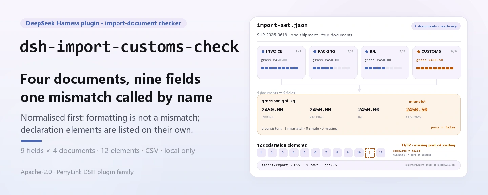

<div align="center">

<picture>
  <source media="(prefers-color-scheme: dark)" srcset="docs/assets/dsh-import-customs-check-hero-en-dark.webp">
  
</picture>

# dsh-import-customs-check

**इनवॉइस, पैकिंग लिस्ट, बिल ऑफ़ लेडिंग और कस्टम्स डिक्लेरेशन की फ़ील्ड-दर-फ़ील्ड तुलना करें, फिर डिक्लेरेशन के छूटे हुए 12 तत्वों की सूची पाएँ।**

DeepSeek Harness के लिए पूरी तरह लोकल दस्तावेज़-जाँच टूल: एक तैयार JSON पढ़ें, 9 हेडर फ़ील्ड क्रॉस-चेक करें, डिक्लेरेशन के 12 हेडर तत्व जाँचें और ज़रूरत हो तो CSV निर्यात करें — कोई नेटवर्क नहीं, कोई मॉडल कॉल नहीं, कोई अपलोड नहीं।

[इंस्टॉल](#तीन-चरणों-में-शुरुआत) · [कॉन्फ़िगरेशन](#कॉन्फ़िगरेशन) · [FAQ](#faq) · [简体中文](README.md) · [English](README.en.md) · [Español](README.es.md) · [Português](README.pt.md) · [हिन्दी](README.hi.md)

[](LICENSE)
[](#अनुकूलता)
[](https://www.npmjs.com/package/dsh-import-customs-check)
[](https://github.com/PerryLink/dsh-import-customs-check/actions/workflows/ci.yml)
[](#अनुकूलता)

[](https://github.com/PerryLink/dsh-import-customs-check/stargazers)
[](https://www.npmjs.com/package/dsh-import-customs-check)

```sh
dsh plugin --profile <profile> add dsh-import-customs-check
```

</div>

<sub>समुदाय प्लगइन, DeepSeek से संबद्ध नहीं। आधिकारिक रिपॉज़िटरी: <https://github.com/PerryLink/dsh-import-customs-check>।</sub>

<sub>स्थिति: alpha / public-synthetic / partial / not counted / गैर-GA — कोई वास्तविक कस्टम्स डिक्लेरेशन, ग्राहक डेटा या ग्राहक प्रमाण नहीं; कोई अनुपालन, वर्गीकरण या फ़ाइलिंग निष्कर्ष नहीं।</sub>

## यह क्या है

एक वाक्य में: एक आयात शिपमेंट के चार-दस्तावेज़ JSON (इनवॉइस, पैकिंग लिस्ट, बिल ऑफ़ लेडिंग, कस्टम्स डिक्लेरेशन) पढ़ता है, 9 हेडर फ़ील्ड की तुलना करके «consistent / mismatch / single_source / not_provided» वाली फ़ील्ड-दर-फ़ील्ड तालिका देता है, फिर 12 हेडर तत्वों की सूची से डिक्लेरेशन जाँचता है और ज़रूरत हो तो तालिका CSV में निर्यात करता है।

- **उपयुक्त:** एक आयात शिपमेंट जिसके चारों दस्तावेज़ पहले से JSON में हैं; फ़ाइलिंग से पहले इनवॉइस नंबर, कॉन्ट्रैक्ट नंबर, पैकेज, सकल/शुद्ध वज़न, राशि, मुद्रा, HS कोड और मूल देश की जाँच; डिक्लेरेशन के 12 हेडर तत्व भरे हैं या नहीं, इसकी पुष्टि।
- **अनुपयुक्त:** PDF, स्कैन, चित्र या Excel सीधे इनपुट के रूप में (यहाँ OCR नहीं है; पहले JSON तैयार करें); लाइन-आइटम SKU/मात्रा/इकाई-मूल्य मिलान; वर्गीकरण निर्णय, मूल नियम, सीमा शुल्क मूल्य या लाइसेंस निर्णय; ब्रोकर, सीमा शुल्क प्राधिकरण या वकील का विकल्प; एक फ़ाइल में कई शिपमेंट।

<picture>
  <source media="(prefers-color-scheme: dark)" srcset="docs/assets/dsh-import-customs-check-flow-v5-dark.svg">
  
</picture>

## तीन चरणों में शुरुआत

1. **इंस्टॉल करें** (एक चैनल चुनें):

   ```sh
   # npm चैनल (अनुशंसित; प्रकाशित संस्करण)
   dsh plugin --profile <profile> add dsh-import-customs-check
   # git चैनल (नवीनतम main; git+https://github.com/PerryLink/dsh-import-customs-check.git के बराबर)
   dsh plugin --profile <profile> add github:PerryLink/dsh-import-customs-check
   # tarball चैनल: इस रेपो में pnpm pack के बाद
   dsh plugin --profile <profile> add ./dsh-import-customs-check-<version>.tgz
   ```

2. **न्यूनतम कॉन्फ़िग** (कोई Config कुंजी नहीं; `cordis.patch.yml` केवल यह पंक्ति जोड़ता है):

   ```yaml
   - insert:
       - id: dsh-import-customs-check
         name: dsh-import-customs-check
   ```

3. **जाँचें कि यह माउंट होता है**:

   ```sh
   dsh --profile <profile> --dump-config | grep dsh-import-customs-check
   node samples/quickstart/run.mjs --check
   ```

**अनइंस्टॉल**: `dsh plugin --profile <profile> remove dsh-import-customs-check` (या प्रोफ़ाइल patch से पंक्ति हटाएँ)।

## मुख्य क्षमताएँ

टूल के नाम स्थिर API हैं; विवरण रनटाइम आउटपुट से मेल खाने के लिए अंग्रेज़ी में रखे गए हैं।

| टूल | उद्देश्य | जोखिम |
|---|---|---|
| `import.check` | चारों दस्तावेज़ों में 9 हेडर फ़ील्ड का मिलान; `strict=true` पर अंतर होने से त्रुटि | R0 |
| `import.elements` | डिक्लेरेशन के 12 अनिवार्य हेडर तत्व जाँचकर छूटे तत्वों की सूची | R0 |
| `import.export` | फ़ील्ड-जाँच तालिका को CSV में लिखकर पथ + sha256 देता है | R1 स्थानीय लेखन |

- **प्रति-फ़ील्ड चार स्थितियाँ** — `consistent` / `mismatch` / `single_source` / `not_provided`; `summary` गिनती रखता है और `pass = mismatch === 0`, इसलिए केवल एक दस्तावेज़ वाला फ़ील्ड कभी अंतर नहीं समझा जाता।
- **सख्त गेट** — `strict: true` के साथ कोई भी `mismatch` `E_IMPORT_FIELD_MISMATCH` फेंकता है, ऑटोमेशन के लिए तैयार; डिफ़ॉल्ट मोड केवल रिपोर्ट करता है।
- **12 तत्वों की पूर्णता** — `import.elements` डिक्लेरेशन हेडर अलग जाँचता है और `{ complete, total, present, missing }` देता है; हर छूटे तत्व के साथ `key` और चीनी लेबल।
- **निश्चित सामान्यीकरण** — इनवॉइस/कॉन्ट्रैक्ट/मूल देश अपरकेस और रिक्त स्थान संकुचित, HS कोड से बिंदु/स्पेस/हाइफ़न हटाए जाते हैं, वज़न 0.001 kg और राशि 0.01 half-up; `CN` ↔ `China` जैसा अर्थ-आधारित मैपिंग नहीं।
- **केवल लोकल, केवल पढ़ने योग्य** — बताई गई JSON पढ़ता है, केवल `$DSH_HOME/dsh-import-customs-check/exports/` में लिखता है; नेटवर्क नहीं, मॉडल कॉल नहीं, अपलोड नहीं, स्रोत फ़ाइल कभी नहीं बदलती।
- **त्रुटि के साथ अगला कदम** — हर त्रुटि `<एक वाक्य>（E_IMPORT_XXX）｜下一步：<एक क्रिया>` है; «त्रुटि कोड» देखें।

## इनपुट

- एक शिपमेंट के लिए UTF-8 JSON; चारों दस्तावेज़ अनिवार्य हैं:

```json
{
  "shipment_id": "SHP-2026-0618",
  "documents": {
    "invoice": { "invoice_no": "INV-2026-0618", "contract_no": "CT-2026-0042", "packages": 120,
                 "gross_weight_kg": "2450.00", "net_weight_kg": "2280.00", "amount": "184500.00",
                 "currency": "USD", "hs_code": "8471.30.00", "origin_country": "CN" },
    "packing_list": { "invoice_no": "INV-2026-0618", "packages": "120", "gross_weight_kg": "2450.00" },
    "bill_of_lading": { "invoice_no": "INV-2026-0618", "packages": "120", "gross_weight_kg": "2450.00" },
    "customs_declaration": { "declaration_no": "3101202606180001", "port_of_loading": "上海港" }
  }
}
```

- दस्तावेज़ कुंजियाँ: `invoice`, `packing_list`, `bill_of_lading`, `customs_declaration`। चीनी उपनाम भी चलते हैं:

```text
商业发票 / 装箱单 / 提单 / 报关单
```

- चारों अनिवार्य हैं। फ़ील्ड दस्तावेज़ ऑब्जेक्ट पर सीधे या `fields` ऑब्जेक्ट के नीचे रखे जा सकते हैं। अंग्रेज़ी और चीनी फ़ील्ड उपनाम काम करते हैं:

```text
invoice_no / 发票号
gross_weight_kg / 毛重
```

- राशि और किलोग्राम वज़न स्ट्रिंग या JSON संख्या हो सकते हैं। तुलना परिशुद्धता राशि के लिए 0.01 और वज़न के लिए 0.001 kg है।
- आकार: प्रति फ़ाइल 5 MB तक; केवल पढ़ने योग्य, स्रोत JSON कभी नहीं बदलता।
- स्रोत: उपयोगकर्ता द्वारा तैयार स्थानीय JSON; बंडल किया गया नमूना सिंथेटिक है और इसमें कोई वास्तविक कंपनी या डिक्लेरेशन डेटा नहीं है।

## आउटपुट

- `import.check`: फ़ील्ड-दर-फ़ील्ड तालिका। हर फ़ील्ड में `status`, `compared` (कितने दस्तावेज़ों ने दिया), `values` (प्रति दस्तावेज़ कच्चा मान, सामान्यीकृत मान और अमान्य ध्वज) और `note`। `summary` में `consistent / mismatch / single_source / not_provided` की गिनती, और `pass = mismatch === 0`।
- `import.elements`: डिक्लेरेशन के 12 हेडर तत्वों की पूर्णता `{ complete, total, present, missing: [{ key, label }] }` के रूप में।
- `import.export`: फ़ील्ड तालिका `$DSH_HOME/dsh-import-customs-check/exports/` में लिखता है, प्रति फ़ील्ड एक पंक्ति और प्रति दस्तावेज़ एक कॉलम; पथ, `sha256`, बाइट्स और पंक्तियाँ लौटाता है।

| status | अर्थ | विफलता मानी जाती है? |
|---|---|---|
| `consistent` | कम से कम 2 दस्तावेज़ यह फ़ील्ड देते हैं और सभी एक ही मान पर सामान्यीकृत होते हैं | नहीं |
| `mismatch` | सामान्यीकृत मान भिन्न हैं, या दिया गया मान अमान्य है | हाँ (`pass=false`) |
| `single_source` | केवल 1 दस्तावेज़ यह फ़ील्ड देता है, इसलिए मिलान संभव नहीं | नहीं |
| `not_provided` | चारों दस्तावेज़ों में यह फ़ील्ड नहीं है | नहीं |

`import.check` डिफ़ॉल्ट रूप से पूरी तालिका देता है। `strict: true` के साथ कोई भी `mismatch` `E_IMPORT_FIELD_MISMATCH` फेंकता है, जो स्वचालित गेट के लिए उपयुक्त है।

## उदाहरण

यह पंक्ति एजेंट में चिपकाएँ (बंडल किया गया प्रॉम्प्ट चीनी में है):

```text
我有一套进口单证（发票、装箱单、提单、报关单），帮我核对 9 个字段是否一致，再看报关单 12 项要素缺什么。
```

बंडल किए गए नमूने को फिर चलाएँ और गोल्डन फ़ाइल से मिलाएँ:

```sh
node samples/quickstart/run.mjs --check
```


नमूना एक सिंथेटिक शिपमेंट है। सकल वज़न जानबूझकर डिक्लेरेशन पर `2450.50` और अन्य तीन दस्तावेज़ों पर `2450.00` है (एक `mismatch`); HS कोड इनवॉइस पर `8471.30.00` और डिक्लेरेशन पर `84713000` है, जो सामान्यीकरण के बाद एक ही मान है (फ़ॉर्मैट अंतर नहीं); डिक्लेरेशन जानबूझकर `port_of_loading` छोड़ता है ताकि छूटा तत्व दिखे। `samples/quickstart/expected/result.json` `node samples/quickstart/run.mjs --json` का वास्तविक आउटपुट है, हाथ से लिखा नहीं; कच्चा लॉग [`docs/assets/quickstart.log`](docs/assets/quickstart.log) में है।

## कॉन्फ़िगरेशन

इस प्लगइन में **कोई Config कुंजी नहीं** है — सब कुछ तीन टूल के कॉल पैरामीटर से नियंत्रित होता है:

| टूल | पैरामीटर | अनिवार्य | अर्थ |
|---|---|---|---|
| `import.check` | `path` | हाँ | एक-शिपमेंट import-set JSON का पूर्ण पथ |
| `import.check` | `strict` | नहीं | `true` पर कोई भी `mismatch` `E_IMPORT_FIELD_MISMATCH` फेंकता है; डिफ़ॉल्ट `false` |
| `import.elements` | `path` | हाँ | ऊपर जैसा |
| `import.export` | `path` | हाँ | ऊपर जैसा |
| `import.export` | `filename` | नहीं | निर्यात फ़ाइल नाम, केवल `[A-Za-z0-9._-]`; डिफ़ॉल्ट `import-check-<input_sha256 के पहले 12 अक्षर>.csv` |

कॉल उदाहरण (टूल सतह):

```sh
# 1) फ़ील्ड-दर-फ़ील्ड स्थिरता
#    टूल सतह: import.check({ path: "/abs/path/import-set.json" })

# 2) सख्त गेट (अंतर पर विफल)
#    टूल सतह: import.check({ path: "/abs/path/import-set.json", strict: true })

# 3) डिक्लेरेशन तत्व
#    टूल सतह: import.elements({ path: "/abs/path/import-set.json" })

# 4) जाँच तालिका निर्यात
#    टूल सतह: import.export({ path: "/abs/path/import-set.json" })
```

परीक्षण `DSH_IMPORT_CUSTOMS_CHECK_HOME` पर्यावरण चर से स्थानीय लेखन रूट बदल सकते हैं; डिफ़ॉल्ट ठीक `$DSH_HOME/dsh-import-customs-check` है।

## तुलना नियम

| फ़ील्ड | कुंजी | सामान्यीकरण |
|---|---|---|
| इनवॉइस नंबर | `invoice_no` | ट्रिम, रिक्त स्थान संकुचित, अपरकेस |
| कॉन्ट्रैक्ट नंबर | `contract_no` | वही |
| पैकेज | `packages` | अल्पविराम/स्पेस हटाएँ, धनात्मक पूर्णांक |
| सकल वज़न | `gross_weight_kg` | अल्पविराम/स्पेस हटाएँ, 0.001 kg half-up |
| शुद्ध वज़न | `net_weight_kg` | वही |
| राशि | `amount` | अल्पविराम/स्पेस हटाएँ, 0.01 half-up |
| मुद्रा | `currency` | 3 अक्षर, अपरकेस |
| HS कोड | `hs_code` | बिंदु/स्पेस/हाइफ़न हटाएँ, 6/8/10 अंक |
| मूल देश | `origin_country` | ट्रिम, रिक्त स्थान संकुचित, अपरकेस |

## घोषणा के 12 तत्व

| # | कुंजी | तत्व |
|---:|---|---|
| 1 | `declaration_no` | डिक्लेरेशन नंबर |
| 2 | `declaration_date` | डिक्लेरेशन तिथि |
| 3 | `domestic_consignee` | घरेलू प्रेषक/प्राप्तकर्ता |
| 4 | `overseas_consignor` | विदेशी प्रेषक/प्राप्तकर्ता |
| 5 | `transport_mode` | परिवहन मोड |
| 6 | `transport_name` | परिवहन साधन का नाम |
| 7 | `bill_of_lading_no` | बिल ऑफ़ लेडिंग नंबर |
| 8 | `supervision_mode` | पर्यवेक्षण मोड |
| 9 | `duty_nature` | शुल्क प्रकृति |
| 10 | `origin_country` | मूल देश/क्षेत्र |
| 11 | `port_of_loading` | लोडिंग पोर्ट |
| 12 | `domestic_destination` | घरेलू गंतव्य |

ये 12 **इस पैकेज की सहमत हेडर सूची** हैं, किसी सीमा शुल्क प्रणाली या किसी विशेष पोर्ट का कानूनी सत्यापन नियम नहीं। वास्तविक फ़ाइलिंग आवश्यकताएँ नवीनतम सीमा शुल्क निर्देशों का पालन करती हैं।

## FAQ

<details>
<summary>कोई दस्तावेज़ छूट जाए तो क्या होता है?</summary>

`import.check` और `import.elements` दोनों `E_IMPORT_DOC_MISSING` फेंकते हैं और विवरण बताता है क्या छूटा (जैसे «छूटा: बिल ऑफ़ लेडिंग»)। पैकेज तीन से चौथा दस्तावेज़ नहीं अनुमान लगाता; उसे जोड़कर फिर चलाएँ। यदि कोई दस्तावेज़ वास्तव में लागू नहीं होता, तो व्यावसायिक प्रक्रिया में पुष्टि करें, कुंजी न हटाएँ।

</details>

<details>
<summary>`mismatch` और `E_IMPORT_FIELD_MISMATCH` में क्या अंतर है?</summary>

`mismatch` परिणाम तालिका की स्थिति है; डिफ़ॉल्ट रूप से केवल रिपोर्ट होती है, रुकावट नहीं। `E_IMPORT_FIELD_MISMATCH` `strict: true` पर उठने वाली त्रुटि है। स्वचालित गेट में strict मोड और मानवीय समीक्षा में डिफ़ॉल्ट तालिका इस्तेमाल करें।

</details>

<details>
<summary>`port_of_loading` छूटा होना `mismatch` क्यों नहीं है?</summary>

12 तत्वों की पूर्णता अलग टूल (`import.elements`) जाँचता है और नौ स्थिरता फ़ील्ड में नहीं मिलाया जाता। तत्व छूटने पर `complete=false` होता है और `missing` सूची देती है; इससे `import.check` का `pass` नहीं बदलता।

</details>

<details>
<summary>HS कोड का अलग फ़ॉर्मैट झूठा अंतर बताएगा?</summary>

नहीं। तुलना से पहले बिंदु, स्पेस और हाइफ़न हटाए जाते हैं, इसलिए `8471.30.00` और `84713000` एक ही माने जाते हैं (8 अंक)। छह, आठ और दस अंक अलग ग्रैन्युलैरिटी हैं और `mismatch` बताए जाते हैं। पैकेज कोड की शुद्धता का निर्णय नहीं करता।

</details>

<details>
<summary>वज़न और राशि की परिशुद्धता क्या है?</summary>

वज़न 0.001 kg और राशि 0.01 पर तुलना होती है, half-up पूर्णांकन के साथ; `2450.0006` → `2450.001` और `184500.005` → `184500.01`। यह तुलना नीति है, सीमा शुल्क या बैंक की मूल्यांकन/निपटान नीति नहीं।

</details>

<details>
<summary>क्या यह मेरी फ़ाइल बदलता या अपलोड करता है?</summary>

नहीं। बताई गई JSON पढ़ता है, केवल `$DSH_HOME/dsh-import-customs-check/exports/` में लिखता है, और कभी नेटवर्क, मॉडल कॉल या अपलोड नहीं करता।

</details>

## अनुमतियाँ और डेटा

पढ़ना: उपयोगकर्ता द्वारा बताया गया आयात दस्तावेज़-सेट JSON (नमूना: `samples/quickstart/input/import-set.json`); और कुछ नहीं।
लिखना: केवल `$DSH_HOME/dsh-import-customs-check/exports/`; स्रोत JSON नहीं बदलता।
नेटवर्क: नहीं।
बाहरी सिस्टम: कोई नहीं।

`import.check` और `import.elements` **R0** (केवल पढ़ना) हैं। `import.export` **R1** (स्थानीय लेखन, `$DSH_HOME/dsh-import-customs-check/exports/` में) है। परीक्षण `DSH_IMPORT_CUSTOMS_CHECK_HOME` से स्थानीय लेखन रूट बदल सकते हैं; डिफ़ॉल्ट ठीक `$DSH_HOME/dsh-import-customs-check` है।

## त्रुटि कोड

| कोड | कब | अगला कदम |
|---|---|---|
| `E_IMPORT_DOC_MISSING` | चार में से एक दस्तावेज़ छूटा, JSON खराब है, दस्तावेज़ ऑब्जेक्ट नहीं है, दोहराव है, या फ़ाइल खाली/5 MB से बड़ी है | चारों दस्तावेज़ दें और JSON की संरचना जाँचें |
| `E_IMPORT_FIELD_MISMATCH` | `strict: true` और कम से कम एक फ़ील्ड `mismatch` है | `import.check` तालिका देखें, दस्तावेज़ सुधारें, फिर चलाएँ |
| `E_IMPORT_PATH_INVALID` | इनपुट पथ नहीं है / डायरेक्टरी है / पढ़ा नहीं जा सकता, निर्यात डायरेक्टरी लिखने योग्य नहीं, या निर्यात फ़ाइल नाम असुरक्षित है | मौजूद JSON दें; निर्यात में केवल `[A-Za-z0-9._-]` दें |

संदेश का प्रारूप `<एक वाक्य>（E_IMPORT_XXX）｜下一步：<एक क्रिया>` है। अधिक जानकारी [TROUBLESHOOTING.md](TROUBLESHOOTING.md) में।

## स्वीकृति प्रमाण

सार्वजनिक/सिंथेटिक fixture `samples/quickstart/` में हैं; `ACCEPTANCE.csv` जाँचें दर्ज करता है। quickstart पंक्ति के अलावा सभी पंक्तियाँ `counted=false` हैं। पूरी 11 पंक्तियाँ `node scripts/gate.mjs` से एक-एक करके सत्यापित होती हैं, सभी `true`।

| req_id | metric | threshold | actual | pass | source | counted |
|---|---|---|---|---|---|---|
| IMP-A01 | field check | fields=9 consistent=8 mismatch=1 | fields=9 consistent=8 mismatch=1 | true | public/synthetic | false |
| IMP-A03 | gross weight mismatch | 4 sources declaration=2450.50 | 4 sources declaration=2450.50 | true | public/synthetic | false |
| IMP-A05 | 12 elements | present=11 missing=1 | present=11 missing=1 | true | public/synthetic | false |
| PS1-QS01 | quickstart golden | 1/1 | 1 | true | synthetic/quickstart | true |

*ये fixture-आधारित स्वीकृति पंक्तियाँ हैं, वास्तविक सीमा शुल्क रन नहीं; कोई आउटपुट नहीं गढ़ा गया।*

## सुरक्षा सीमाएँ और ज्ञात सीमाएँ

- **केवल पढ़ने योग्य इनपुट।** एकमात्र लेखन पथ `$DSH_HOME/dsh-import-customs-check/exports/` है; स्रोत JSON कभी नहीं बदलता।
- **नेटवर्क नहीं, मॉडल कॉल नहीं, अपलोड नहीं।** चारों दस्तावेज़, नौ फ़ील्ड और बारह तत्व स्थानीय रूप से पढ़े और तुलना किए जाते हैं; कोई दूरस्थ सेवा और मॉडल लागत नहीं।
- **नियंत्रित निर्यात पथ।** निर्यात डायरेक्टरी निश्चित है और फ़ाइल नाम केवल `[A-Za-z0-9._-]` स्वीकार करता है; पथ विभाजक, `..`, स्पेस, गैर-ASCII और बहुत लंबे नाम अस्वीकृत।
- **विफलता-बंद।** दस्तावेज़ छूटना, खराब JSON, ऑब्जेक्ट न होना या अपठनीय पथ `E_IMPORT_*` त्रुटि देता है; आधे डेटा से अनुमान नहीं लगाता और आधा CSV नहीं लिखता।
- **CSV इंजेक्शन सीमा।** निर्यात केवल RFC 4180 कोटिंग करता है और Excel फ़ॉर्मूला प्रीफ़िक्स (`= + - @` से शुरू सेल) साफ़ नहीं करता; अज्ञात स्रोत की CSV सीधे Excel में न खोलें।
- **इनपुट तैयार JSON है:** PDF, स्कैन, चित्र या Excel नहीं, OCR नहीं, और कस्टम्स-डिक्लेरेशन XML/सिंगल-विंडो संदेश पार्स नहीं।
- केवल नौ हेडर फ़ील्ड और 12 हेडर तत्व: लाइन आइटम, SKU, मात्रा, इकाई मूल्य, मूल नियम, वर्गीकरण, सीमा शुल्क मूल्य या लाइसेंस निर्णय नहीं।
- कोई अर्थ-आधारित मैपिंग नहीं: `CN` बनाम `China` और `USD` बनाम `US$` अलग मान हैं; स्रोत को सामान्यीकृत करें।
- HS कोड केवल फ़ॉर्मैट और स्थिरता के लिए जाँचे जाते हैं, शुद्धता या प्रयोज्यता के लिए नहीं।
- 12 तत्व इस पैकेज की हेडर सूची हैं, कानूनी नियम नहीं; ब्रोकर, सीमा शुल्क प्राधिकरण या वकील का विकल्प नहीं।
- राशि/वज़न तुलना निश्चित half-up परिशुद्धता से होती है; मुद्रा विनिमय या इकाई रूपांतरण (जैसे lbs → kg) नहीं।
- केवल लोकल; केवल सार्वजनिक/सिंथेटिक नमूने; alpha/partial, not counted, GA या उत्पादन-तैयारी का दावा नहीं।

## अनुकूलता

| सतह | स्थिति |
|---|---|
| Harness | `dsh >=0.2.1-rc.3 <0.4.0` |
| Node | `>=24.9.0 <25` |
| प्लेटफ़ॉर्म | सभी; केवल स्थानीय फ़ाइलें |
| डेटा | नेटवर्क नहीं, मॉडल कॉल नहीं, अपलोड नहीं |

## पारिस्थितिकी और गुणवत्ता

- [npm पैकेज](https://www.npmjs.com/package/dsh-import-customs-check) (`0.1.0` प्रकाशित, README और tarball के साथ)
- [डोमेन इंडेक्स](https://perrylink.github.io/dsh-plugins/) (PerryLink प्लगइन कैटलॉग, इसमें यह प्लगइन भी है)
- [CI वर्कफ़्लो](https://github.com/PerryLink/dsh-import-customs-check/actions/workflows/ci.yml) (`ci.yml` का वास्तविक रन इतिहास)

## संबंधित कार्य

- [dsh-hs-candidate](https://github.com/PerryLink/dsh-hs-candidate) (HS उम्मीदवार और 12 वर्गीकरण तत्व)
- [dsh-freight-audit](https://github.com/PerryLink/dsh-freight-audit) (फ़्रेट बिल ऑडिट)
- [डोमेन इंडेक्स](https://perrylink.github.io/dsh-plugins/)

## विकास

```sh
pnpm install --frozen-lockfile
pnpm build && pnpm lint && pnpm typecheck
node --test test/*.test.mjs
node scripts/gate.mjs
```

वर्तमान संस्करण `0.1.0`; 58 परीक्षण पास (`node --test test/*.test.mjs`)। रिलीज़ गेट: `node scripts/gate.mjs` (मेटाडेटा lint + सभी सार्वजनिक स्वीकृति पंक्तियाँ + तीनों स्थिर त्रुटि कोड का अभ्यास)। README की छवियाँ [`scripts/gen-readme-assets.py`](scripts/gen-readme-assets.py) से प्रोग्रामेटिक रूप से बनती हैं: hero बैनर Pillow से (zh / en × हल्का / गहरा, चार फ़ाइलें) और संरचना-चित्र हाथ से लिखे SVG के रूप में (हल्का और गहरा), जिन्हें `python scripts/gen-readme-assets.py` से दोबारा चलाया जा सकता है; पुराना एक-रूप फ़्लो चित्र बाहरी लिंक के लिए `docs/assets/` में रहता है, जबकि README केवल नए hero सेट और flow-v5 जोड़े का संदर्भ देते हैं। `docs/assets/quickstart.png` वास्तविक कैप्चर है, `docs/assets/quickstart.log` के साथ रखा गया है।

Topics: `dsh`, `dsh-plugin`, `deepseek-harness`, `import`, `customs`, `trade-compliance`, `document-check`, `packing-list`, `bill-of-lading`, `perrylink`

## परिवार और आभार

यह परियोजना [PerryLink](https://github.com/PerryLink) के DeepSeek Harness प्लगइन परिवार का हिस्सा है (सभी Apache-2.0)। अगर यह उपयोगी हो, **एक स्टार अगले व्यक्ति को इसे खोजने में मदद करता है** — इसके पीछे कोई सुविधा बंद नहीं है।

- [@PerryLink](https://github.com/PerryLink) — निर्माता और अनुरक्षक: चार-दस्तावेज़ पार्सर और फ़ील्ड सामान्यीकरण, नौ-फ़ील्ड क्रॉस-चेक, 12-तत्व जाँच, CSV निर्यात, quickstart गोल्डन नमूना और पाँच-भाषा दस्तावेज़।

## लाइसेंस

[LICENSE](LICENSE) (Apache License 2.0) © 2026 dsh-import-customs-check contributors. `NOTICE` और `THIRD-PARTY-NOTICES` भी देखें।

<p align="center"><sub>Apache-2.0 · समुदाय प्लगइन, DeepSeek से संबद्ध नहीं।</sub></p>
