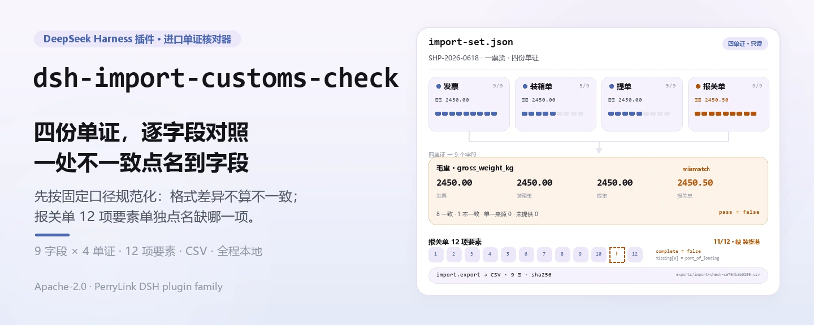
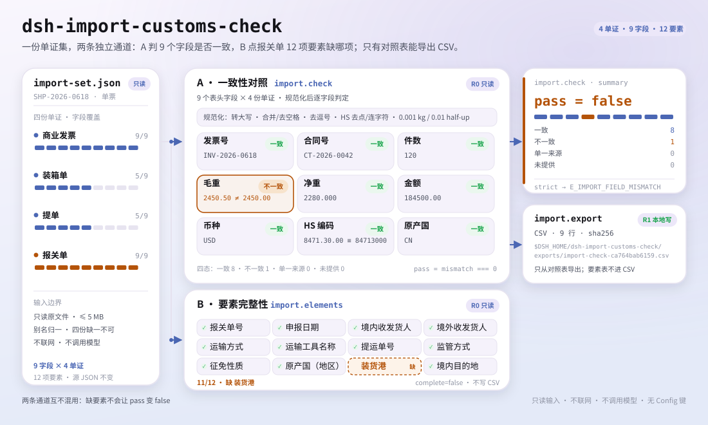

<div align="center">

<picture>
  <source media="(prefers-color-scheme: dark)" srcset="docs/assets/dsh-import-customs-check-hero-zh-dark.webp">
  
</picture>

# dsh-import-customs-check

**把发票、装箱单、提单、报关单四份进口单证逐字段对照，并列出报关单 12 项要素的缺项。**

面向 DeepSeek Harness 的纯本地进口单证核对工具：读一份整理好的 JSON，交叉核对 9 个表头字段、检查报关单 12 项表头要素、需要时导出 CSV——不联网、不调用模型、不上传。

[安装](#三步上手) · [配置](#配置) · [FAQ](#faq) · [简体中文](README.md) · [English](README.en.md) · [Español](README.es.md) · [Português](README.pt.md) · [हिन्दी](README.hi.md)

[](LICENSE)
[](#兼容性)
[](https://www.npmjs.com/package/dsh-import-customs-check)
[](https://github.com/PerryLink/dsh-import-customs-check/actions/workflows/ci.yml)
[](#兼容性)

[](https://github.com/PerryLink/dsh-import-customs-check/stargazers)
[](https://www.npmjs.com/package/dsh-import-customs-check)

```sh
dsh plugin --profile <profile> add dsh-import-customs-check
```

</div>

<sub>社区插件，与 DeepSeek 官方无关。唯一仓库：<https://github.com/PerryLink/dsh-import-customs-check>。</sub>

<sub>状态：alpha / 公开合成 / partial / not counted / 非 GA——不含真实报关单、客户数据或客户证据，也不作合规、归类或申报结论声明。</sub>

## 它是什么

一句话：读一票进口货物的四份单证 JSON（发票、装箱单、提单、报关单），把 9 个表头字段逐项对照，输出「一致 / 不一致 / 单一来源 / 未提供」的逐字段表；再按 12 项表头清单检查报关单缺什么；需要留档时把逐字段表导出成 CSV。

- **适合**：一票进口货物的发票、装箱单、提单、报关单已经整理成 JSON；想在申报前核对发票号、合同号、件数、毛重、净重、金额、币种、HS 编码、原产国是否一致；想确认报关单 12 项表头要素有没有漏填。
- **不适合**：PDF、扫描件、图片或 Excel 直接输入（本包不做 OCR，请先人工整理成 JSON）；商品行级别的 SKU / 数量 / 单价核对；归类裁定、原产地规则、完税价格或监管证件判断；替代报关行、海关或律师的合规意见；多票货物混在一个文件里。

<picture>
  <source media="(prefers-color-scheme: dark)" srcset="docs/assets/dsh-import-customs-check-flow-v5-dark.svg">
  
</picture>

## 三步上手

1. **安装**（三选一）：

   ```sh
   # npm 通道（推荐，已发布版本）
   dsh plugin --profile <profile> add dsh-import-customs-check
   # git 通道（最新 main；等价于 git+https://github.com/PerryLink/dsh-import-customs-check.git）
   dsh plugin --profile <profile> add github:PerryLink/dsh-import-customs-check
   # tarball 通道：本仓库 pnpm pack 后
   dsh plugin --profile <profile> add ./dsh-import-customs-check-<version>.tgz
   ```

2. **最小配置**（无需任何 Config 键，`cordis.patch.yml` 只插入这一行）：

   ```yaml
   - insert:
       - id: dsh-import-customs-check
         name: dsh-import-customs-check
   ```

3. **验证已生效**：

   ```sh
   dsh --profile <profile> --dump-config | grep dsh-import-customs-check
   node samples/quickstart/run.mjs --check
   ```

**卸载**：`dsh plugin --profile <profile> remove dsh-import-customs-check`（或从 profile patch 删掉该行）。

## 核心能力

工具名是稳定 API；工具说明保留英文以匹配运行时输出。

| 工具 | 用途 | 风险 |
|---|---|---|
| `import_check` | 对 9 个表头字段做四单证一致性核对，返回逐字段表；`strict=true` 时不一致即报错 | R0 |
| `import_elements` | 检查报关单 12 项必填要素，返回缺项列表 | R0 |
| `import_export` | 把逐字段核对表导出成 CSV，返回路径与 sha256 | R1 本地写 |

- **逐字段状态** —— `consistent` / `mismatch` / `single_source` / `not_provided` 四态；`summary` 计数，`pass = mismatch === 0`，不会把「只有一份单证提供」误判成不一致。
- **严格门禁** —— 传 `strict: true` 时，任意 `mismatch` 都会抛 `E_IMPORT_FIELD_MISMATCH`，适合接进自动流程；默认模式只报告、不中断。
- **12 项要素完整性** —— `import_elements` 独立检查报关单表头，返回 `{ complete, total, present, missing }`，缺项带 `key` 与中文标签。
- **固定规范化口径** —— 发票号/合同号/原产国转大写并合并空格，HS 去点/空格/连字符，重量按 0.001 kg、金额按 0.01 half-up；不做 `CN` ↔ `China` 这类语义映射。
- **纯本地、只读** —— 只读用户指定的 JSON，只写 `$DSH_HOME/dsh-import-customs-check/exports/`；不联网、不调用模型、不上传，源文件永不修改。
- **报错带下一步** —— 每个错误都是 `<一句人话>（E_IMPORT_XXX）｜下一步：<一个动作>`，见「错误码」。

## 输入

- 格式：UTF-8 JSON，单票货物，四份单证必须齐全：

```json
{
  "shipment_id": "SHP-2026-0618",
  "documents": {
    "invoice": { "invoice_no": "INV-2026-0618", "contract_no": "CT-2026-0042", "packages": 120,
                 "gross_weight_kg": "2450.00", "net_weight_kg": "2280.00", "amount": "184500.00",
                 "currency": "USD", "hs_code": "8471.30.00", "origin_country": "CN" },
    "packing_list": { "invoice_no": "INV-2026-0618", "packages": "120", "gross_weight_kg": "2450.00" },
    "bill_of_lading": { "invoice_no": "INV-2026-0618", "packages": "120", "gross_weight_kg": "2450.00" },
    "customs_declaration": { "declaration_no": "3101202606180001", "port_of_loading": "上海港" }
  }
}
```

- 单证键：`invoice`、`packing_list`、`bill_of_lading`、`customs_declaration`；也接受 `商业发票 / 装箱单 / 提单 / 报关单` 等别名。四份缺一不可。
- 字段可直接放在单证对象里，也可放在 `fields` 子对象里；字段名支持英文和中文别名（如 `invoice_no` / `发票号`、`gross_weight_kg` / `毛重`）。
- 美元/人民币金额、公斤重量可写成字符串或 JSON 数字；比较精度分别是 0.01 和 0.001 kg。
- 大小：单个文件 ≤ 5 MB；只读，不改原文件。
- 来源：用户自己整理的本地 JSON；样例是合成单证，不含真实企业或报关数据。

## 输出

- `import_check`：逐字段表。每个字段一行，含 `status`、`compared`（提供该字段的单证数）、`values`（每份单证的原始值、规范化值、是否格式错误）和 `note`。`summary` 统计 `consistent / mismatch / single_source / not_provided`，`pass = mismatch === 0`。
- `import_elements`：报关单 12 项必填要素的完整性，返回 `{ complete, total, present, missing: [{ key, label }] }`。
- `import_export`：把逐字段表写到 `$DSH_HOME/dsh-import-customs-check/exports/`，一行一个字段、一列一份单证，返回路径、`sha256`、字节数和行数。

状态含义：

| status | 含义 | 是否算失败 |
|---|---|---|
| `consistent` | 至少 2 份单证提供该字段，规范化后完全一致 | 否 |
| `mismatch` | 规范化后不一致，或有单证的值格式非法 | 是（`pass=false`） |
| `single_source` | 只有 1 份单证提供该字段，无法交叉核对 | 否 |
| `not_provided` | 四份单证都没有这个字段 | 否 |

`import_check` 默认返回完整表格；传 `strict: true` 时，只要有 `mismatch` 就抛 `E_IMPORT_FIELD_MISMATCH`，适合放进自动门禁。

## 示例

直接复制下面这句发给 agent：

```text
我有一套进口单证（发票、装箱单、提单、报关单），帮我核对 9 个字段是否一致，再看报关单 12 项要素缺什么。
```

用自带样例复跑并核对金标：

```sh
node samples/quickstart/run.mjs --check
```


样例是一票合成货物：四份单证齐全，毛重在报关单上故意写成 `2450.50`（其余三份 `2450.00`），用来演示 `mismatch`；HS 编码在发票上是 `8471.30.00`、报关单上是 `84713000`，规范化后一致，用来演示格式差异不算不一致；报关单故意漏填 `port_of_loading`（装货港），用来演示 12 项要素缺项。金标 `samples/quickstart/expected/result.json` 由 `node samples/quickstart/run.mjs --json` 真实产生，不是手写；原始日志保存在 [`docs/assets/quickstart.log`](docs/assets/quickstart.log)。

## 配置

本插件**没有 Config 键**——挂载后即全部可用，所有可调项都在三个工具的调用参数上：

| 工具 | 参数 | 必填 | 含义 |
|---|---|---|---|
| `import_check` | `path` | 是 | 单票进口单证集 JSON 的绝对路径 |
| `import_check` | `strict` | 否 | `true` 时任意 `mismatch` 抛 `E_IMPORT_FIELD_MISMATCH`；默认 `false` |
| `import_elements` | `path` | 是 | 同上 |
| `import_export` | `path` | 是 | 同上 |
| `import_export` | `filename` | 否 | 导出文件名，只允许 `[A-Za-z0-9._-]`；默认 `import-check-<input_sha256 前 12 位>.csv` |

调用示例（工具面）：

```sh
# 1) 看逐字段一致性
#    工具面：import_check({ path: "/abs/path/import-set.json" })

# 2) 严格门禁（有不一致就报错）
#    工具面：import_check({ path: "/abs/path/import-set.json", strict: true })

# 3) 看报关单要素
#    工具面：import_elements({ path: "/abs/path/import-set.json" })

# 4) 导出核对表
#    工具面：import_export({ path: "/abs/path/import-set.json" })
```

测试可用环境变量 `DSH_IMPORT_CUSTOMS_CHECK_HOME` 覆盖本地写根目录；默认严格等于 `$DSH_HOME/dsh-import-customs-check`。

## 核对规则

| 字段 | key | 规范化 |
|---|---|---|
| 发票号 | `invoice_no` | 去首尾空格、合并空格、转大写 |
| 合同号 | `contract_no` | 同上 |
| 件数 | `packages` | 去逗号/空格，正整数 |
| 毛重 | `gross_weight_kg` | 去逗号/空格，按 0.001 kg half-up |
| 净重 | `net_weight_kg` | 同上 |
| 金额 | `amount` | 去逗号/空格，按 0.01 half-up |
| 币种 | `currency` | 3 位字母，转大写 |
| HS 编码 | `hs_code` | 去点/空格/连字符，6/8/10 位数字 |
| 原产国 | `origin_country` | 去首尾空格、合并空格、转大写 |

## 报关单 12 项要素

| # | key | 要素 |
|---:|---|---|
| 1 | `declaration_no` | 报关单号 |
| 2 | `declaration_date` | 申报日期 |
| 3 | `domestic_consignee` | 境内收发货人 |
| 4 | `overseas_consignor` | 境外收发货人 |
| 5 | `transport_mode` | 运输方式 |
| 6 | `transport_name` | 运输工具名称 |
| 7 | `bill_of_lading_no` | 提运单号 |
| 8 | `supervision_mode` | 监管方式 |
| 9 | `duty_nature` | 征免性质 |
| 10 | `origin_country` | 原产国（地区） |
| 11 | `port_of_loading` | 装货港 |
| 12 | `domestic_destination` | 境内目的地 |

这 12 项是**本包约定的表头完整性清单**，不是海关申报系统或某个关区的法定校验规则；实际申报以海关最新要求为准。

## FAQ

<details>
<summary>缺一份单证会怎样？</summary>

`import_check` 和 `import_elements` 都会报 `E_IMPORT_DOC_MISSING`，并在细节里写出缺哪一份（如“缺：提单”）。本包不会用三份单证“猜”第四份；请补齐后再跑。若某份单证确实不适用，请先在业务上确认，而不是删 key。

</details>

<details>
<summary>`mismatch` 和 `E_IMPORT_FIELD_MISMATCH` 有什么区别？</summary>

`mismatch` 是结果表里的一个状态，默认只报告、不中断；`E_IMPORT_FIELD_MISMATCH` 是 `strict: true` 时的错误码。把 `import_check` 接进自动流程时用 `strict: true`，人工复核时用默认模式看完整表。

</details>

<details>
<summary>报关单缺 `port_of_loading` 为什么不算 `mismatch`？</summary>

12 项要素完整性由 `import_elements` 单独检查，不与 9 个一致性字段混在一起。缺要素时 `complete=false`、`missing` 列出缺项；它不会让 `import_check` 的 `pass` 变成 false。

</details>

<details>
<summary>HS 编码格式不同会误报吗？</summary>

不会。比较前会去掉点、空格和连字符，只比数字；`8471.30.00` 与 `84713000` 视为一致（8 位）。6 位、8 位、10 位是不同粒度，会如实报 `mismatch`。本包不判断编码本身是否正确。

</details>

<details>
<summary>重量和金额的精度是多少？</summary>

重量按 0.001 kg、金额按 0.01 比较，四舍五入采用 half-up；例如 `2450.0006` 规范化为 `2450.001`，`184500.005` 规范化为 `184500.01`。这是比较口径，不代表海关或银行的计税/结算口径。

</details>

<details>
<summary>会改我的文件或上传数据吗？</summary>

不会。只读用户指定的 JSON；只在本地写 `$DSH_HOME/dsh-import-customs-check/exports/`；不联网、不调用模型、不上传。

</details>

## 权限与数据

读：用户指定的进口单证集 JSON（样例 `samples/quickstart/input/import-set.json`）；不读其他目录。
写：`$DSH_HOME/dsh-import-customs-check/exports/`（CSV 输出）；不改原 JSON。
联网：否。
外部系统：无。

`import_check`、`import_elements` 标 **R0**（只读）；`import_export` 标 **R1**（本地写，只写 `$DSH_HOME/dsh-import-customs-check/exports/`）。测试可用 `DSH_IMPORT_CUSTOMS_CHECK_HOME` 覆盖本地写根目录，默认严格等于 `$DSH_HOME/dsh-import-customs-check`。

## 错误码

| 错误码 | 何时出现 | 下一步 |
|---|---|---|
| `E_IMPORT_DOC_MISSING` | 四份单证缺一、JSON 解析失败、单证不是对象、同一单证重复、文件为空或超 5 MB | 补齐四份单证，检查 JSON 结构 |
| `E_IMPORT_FIELD_MISMATCH` | `strict: true` 且至少一个字段 `mismatch` | 看 `import_check` 表，改单后复跑 |
| `E_IMPORT_PATH_INVALID` | 输入路径不存在/是目录/读不了、导出目录不可写，或导出文件名含路径、空格、中文、超长 | 传存在的 JSON；导出只传 `[A-Za-z0-9._-]` 文件名 |

报错原文格式：`<一句人话>（E_IMPORT_XXX）｜下一步：<一个动作>`。更多排查见 [TROUBLESHOOTING.md](TROUBLESHOOTING.md)。

## 验收证据

公开/合成 fixture 在 `samples/quickstart/`；`ACCEPTANCE.csv` 记录检查，除 quickstart 行外均为 `counted=false`。完整 11 行在 `node scripts/gate.mjs` 中逐行校验，全部为 `true`。

| req_id | metric | threshold | actual | pass | source | counted |
|---|---|---|---|---|---|---|
| IMP-A01 | field check | fields=9 consistent=8 mismatch=1 | fields=9 consistent=8 mismatch=1 | true | public/synthetic | false |
| IMP-A03 | gross weight mismatch | 4 sources declaration=2450.50 | 4 sources declaration=2450.50 | true | public/synthetic | false |
| IMP-A05 | 12 elements | present=11 missing=1 | present=11 missing=1 | true | public/synthetic | false |
| PS1-QS01 | quickstart golden | 1/1 | 1 | true | synthetic/quickstart | true |

*这是 fixture 支撑的验收行，不是真实报关运行；没有编造输出。*

## 安全边界与已知限制

- **只读输入。** 唯一写路径是 `$DSH_HOME/dsh-import-customs-check/exports/`；源 JSON 永不修改。
- **不联网、不调用模型、不上传。** 四份单证、9 个字段与 12 项要素全部在本机解析和比较；没有远端服务、没有模型费用。
- **导出路径受控。** 导出目录固定，文件名只允许 `[A-Za-z0-9._-]`，拒绝路径分隔符、`..`、空格、中文与超长文件名。
- **失败关闭。** 缺单证、JSON 损坏、单证不是对象、路径不可读都直接报 `E_IMPORT_*`，不会用部分数据猜结果，也不会写半份 CSV。
- **CSV 注入边界。** 导出只做 RFC 4180 引号转义，不清理 Excel 公式前缀（以 `= + - @` 开头的单元格）；不要把来源不明的 CSV 直接用 Excel 打开。
- **输入是整理好的 JSON**：不读 PDF、扫描件、图片或 Excel，不做 OCR，也不解析报关单 XML/单一窗口报文。
- 只核对 9 个表头字段和 12 项表头要素：不做商品行、SKU、数量、单价、原产地规则、归类、完税价格或监管证件判断。
- 不做语义映射：`CN` 与 `China`、`USD` 与 `US$` 会被当作不同值；请统一写法。
- HS 编码只做格式与一致性检查，不判断编码是否正确、是否适用于该商品。
- 12 项要素是本包约定的表头清单，不是法定申报规则；不替代报关行、海关或律师意见。
- 金额/重量按固定精度 half-up 比较；不处理汇率、单位换算（如 lbs → kg）或千分位以外的本地化格式。
- 只在本机读写；仅公开/合成样例；alpha/partial、not counted，不作 GA 或生产可用声明。

## 兼容性

| 维度 | 状态 |
|---|---|
| Harness | `dsh >=0.2.1-rc.3 <0.4.0` |
| Node | `>=24.9.0 <25` |
| 平台 | 全平台；仅本地文件 |
| 数据 | 不联网、不调用模型、不上传 |

## 生态与质量

- [npm 包页](https://www.npmjs.com/package/dsh-import-customs-check)（已发布 `0.2.0`，含 README 与 tarball）
- [领域索引](https://perrylink.github.io/dsh-plugins/)（PerryLink 插件目录，含本插件条目）
- [CI 工作流](https://github.com/PerryLink/dsh-import-customs-check/actions/workflows/ci.yml)（`ci.yml` 真实运行记录）

## 相关项目

- [dsh-hs-candidate](https://github.com/PerryLink/dsh-hs-candidate)（HS 候选与 12 项归类要素）
- [dsh-freight-audit](https://github.com/PerryLink/dsh-freight-audit)（运费账单核对）
- [领域索引](https://perrylink.github.io/dsh-plugins/)

## 开发

```sh
pnpm install --frozen-lockfile
pnpm build && pnpm lint && pnpm typecheck
node --test test/*.test.mjs
node scripts/gate.mjs
```

当前版本 `0.2.0`，59 项测试通过（`node --test test/*.test.mjs`）。发布门禁：`node scripts/gate.mjs`（元数据 lint + 公开验收行全过 + 三个稳定错误码全被触发）。README 配图由 [`scripts/gen-readme-assets.py`](scripts/gen-readme-assets.py) 程序化生成：hero 横幅用 Pillow（zh / en × 深浅共四张），结构图是手写 SVG（深浅双版），可重复执行（`python scripts/gen-readme-assets.py`）；旧的单版流程图保留在 `docs/assets/` 供外链使用，README 只引用新生成的 hero 与 flow-v5。`docs/assets/quickstart.png` 为真实运行截图，配合 `docs/assets/quickstart.log` 保留。

Topics：`dsh`、`dsh-plugin`、`deepseek-harness`、`import`、`customs`、`trade-compliance`、`document-check`、`packing-list`、`bill-of-lading`、`perrylink`

## 家族与致谢

本项目是 [PerryLink](https://github.com/PerryLink) 维护的 DeepSeek Harness 插件家族成员（全部 Apache-2.0）。如果这个插件帮到了你，**给个 star**——它不解锁任何功能，但会让下一个人更容易找到它。

- [@PerryLink](https://github.com/PerryLink) —— 创建者与维护者：四单证解析与字段规范化、9 字段核对、12 项要素检查、CSV 导出、quickstart 金标样例与五语文档。

## License

[LICENSE](LICENSE)（Apache License 2.0）© 2026 dsh-import-customs-check contributors。另见 `NOTICE`、`THIRD-PARTY-NOTICES`。

<p align="center"><sub>Apache-2.0 · 社区插件，与 DeepSeek 无关。</sub></p>
