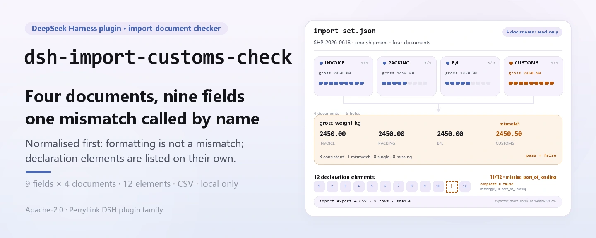

<div align="center">

<picture>
  <source media="(prefers-color-scheme: dark)" srcset="docs/assets/dsh-import-customs-check-hero-en-dark.webp">
  
</picture>

# dsh-import-customs-check

**Compara campo a campo a fatura, a lista de embalagem, o conhecimento de embarque e a declaração aduaneira, e lista os 12 elementos ausentes da declaração.**

Uma ferramenta puramente local para DeepSeek Harness: lê um JSON preparado, cruza 9 campos de cabeçalho, verifica os 12 elementos de cabeçalho da declaração e exporta CSV quando você precisa de um registro — sem rede, sem chamadas ao modelo, sem upload.

[Instalar](#instalação-em-três-passos) · [Configuração](#configuração) · [FAQ](#faq) · [简体中文](README.md) · [English](README.en.md) · [Español](README.es.md) · [Português](README.pt.md) · [हिन्दी](README.hi.md)

[](LICENSE)
[](#compatibilidade)
[](https://www.npmjs.com/package/dsh-import-customs-check)
[](https://github.com/PerryLink/dsh-import-customs-check/actions/workflows/ci.yml)
[](#compatibilidade)

[](https://github.com/PerryLink/dsh-import-customs-check/stargazers)
[](https://www.npmjs.com/package/dsh-import-customs-check)

```sh
dsh plugin --profile <profile> add dsh-import-customs-check
```

</div>

<sub>Plugin da comunidade, não afiliado à DeepSeek. Repositório canônico: <https://github.com/PerryLink/dsh-import-customs-check>.</sub>

<sub>Status: alpha / público-sintético / partial / not counted / não GA — sem declaração aduaneira real, dados de clientes ou evidência de clientes; sem conclusão de conformidade, classificação ou declaração.</sub>

## O que é

Em uma frase: lê o JSON de quatro documentos de um embarque de importação (fatura, lista de embalagem, conhecimento de embarque e declaração aduaneira), compara 9 campos de cabeçalho em uma tabela por campo com estados consistente / divergência / fonte única / não fornecido, verifica a declaração contra a lista de 12 elementos de cabeçalho e exporta a tabela como CSV quando você precisa de um registro.

- **Encaixa:** um embarque de importação cujos quatro documentos já estão em JSON; uma verificação antes da declaração de número de fatura, número de contrato, volumes, peso bruto/líquido, valor, moeda, código HS e país de origem; confirmar que os 12 elementos de cabeçalho da declaração estão preenchidos.
- **Não encaixa:** PDF, digitalizações, imagens ou Excel como entrada direta (aqui não há OCR; prepare o JSON primeiro); conciliação de itens por SKU/quantidade/preço unitário; decisões de classificação, regras de origem, valor aduaneiro ou licenças; substituir um despachante, a autoridade aduaneira ou um advogado; vários embarques em um único arquivo.

<picture>
  <source media="(prefers-color-scheme: dark)" srcset="docs/assets/dsh-import-customs-check-flow-v5-dark.svg">
  
</picture>

## Instalação em três passos

1. **Instale** (escolha um canal):

   ```sh
   # canal npm (recomendado; versão publicada)
   dsh plugin --profile <profile> add dsh-import-customs-check
   # canal git (último main; equivalente a git+https://github.com/PerryLink/dsh-import-customs-check.git)
   dsh plugin --profile <profile> add github:PerryLink/dsh-import-customs-check
   # canal tarball: pnpm pack neste repo e depois
   dsh plugin --profile <profile> add ./dsh-import-customs-check-<version>.tgz
   ```

2. **Configuração mínima** (não há nenhuma chave de Config; o `cordis.patch.yml` apenas insere esta linha):

   ```yaml
   - insert:
       - id: dsh-import-customs-check
         name: dsh-import-customs-check
   ```

3. **Verifique se monta**:

   ```sh
   dsh --profile <profile> --dump-config | grep dsh-import-customs-check
   node samples/quickstart/run.mjs --check
   ```

**Desinstalar**: `dsh plugin --profile <profile> remove dsh-import-customs-check` (ou remova a linha do patch do perfil).

## Capacidades principais

Os nomes das ferramentas são API estável; as descrições permanecem em inglês para coincidir com a saída em tempo de execução.

| Ferramenta | Propósito | Risco |
|---|---|---|
| `import.check` | Cruza os 9 campos de cabeçalho entre os quatro documentos; `strict=true` falha em divergência | R0 |
| `import.elements` | Verifica os 12 elementos de cabeçalho obrigatórios da declaração e lista os ausentes | R0 |
| `import.export` | Grava a tabela de verificação por campo como CSV e retorna caminho + sha256 | R1 escrita local |

- **Quatro estados por campo** — `consistent` / `mismatch` / `single_source` / `not_provided`; `summary` os conta e `pass = mismatch === 0`, então um campo que só um documento traz nunca é confundido com contradição.
- **Portão estrito** — com `strict: true`, qualquer `mismatch` lança `E_IMPORT_FIELD_MISMATCH`, pronto para automação; o modo padrão informa sem interromper.
- **Completude dos 12 elementos** — `import.elements` verifica o cabeçalho da declaração separadamente e retorna `{ complete, total, present, missing }`, com `key` e rótulo chinês em cada ausente.
- **Normalização fixa** — fatura/contrato/origem em maiúsculas e espaços colapsados, código HS sem pontos/espaços/hífens, pesos a 0.001 kg e valores a 0.01 com arredondamento half-up; sem mapeamento semântico como `CN` ↔ `China`.
- **Somente local, somente leitura** — lê o JSON indicado e grava apenas em `$DSH_HOME/dsh-import-customs-check/exports/`; sem rede, sem chamadas ao modelo, sem upload e sem alterar o arquivo de origem.
- **Erros com próxima ação** — cada erro é `<uma frase>（E_IMPORT_XXX）｜下一步：<uma ação>`; ver «Códigos de erro».

## Entrada

- JSON UTF-8 de um único embarque; os quatro documentos são obrigatórios:

```json
{
  "shipment_id": "SHP-2026-0618",
  "documents": {
    "invoice": { "invoice_no": "INV-2026-0618", "contract_no": "CT-2026-0042", "packages": 120,
                 "gross_weight_kg": "2450.00", "net_weight_kg": "2280.00", "amount": "184500.00",
                 "currency": "USD", "hs_code": "8471.30.00", "origin_country": "CN" },
    "packing_list": { "invoice_no": "INV-2026-0618", "packages": "120", "gross_weight_kg": "2450.00" },
    "bill_of_lading": { "invoice_no": "INV-2026-0618", "packages": "120", "gross_weight_kg": "2450.00" },
    "customs_declaration": { "declaration_no": "3101202606180001", "port_of_loading": "上海港" }
  }
}
```

- Chaves de documento: `invoice`, `packing_list`, `bill_of_lading`, `customs_declaration`. Aliases chineses também funcionam:

```text
商业发票 / 装箱单 / 提单 / 报关单
```

- Os quatro são obrigatórios. Os campos podem ficar diretamente no objeto do documento ou sob um objeto `fields`. Aliases de campo em inglês e chinês funcionam:

```text
invoice_no / 发票号
gross_weight_kg / 毛重
```

- Valores e pesos em quilogramas podem ser strings ou números JSON. A precisão de comparação é 0.01 para valores e 0.001 kg para pesos.
- Tamanho: até 5 MB; somente leitura, o JSON de origem nunca é modificado.
- Origem: o JSON local preparado pelo usuário; o exemplo incluído é sintético e não contém dados reais de empresas ou declarações.

## Saída

- `import.check`: tabela por campo. Cada campo tem `status`, `compared` (quantos documentos o fornecem), `values` (valor bruto, valor normalizado e marca de inválido por documento) e `note`. `summary` conta `consistent / mismatch / single_source / not_provided`, e `pass = mismatch === 0`.
- `import.elements`: completude dos 12 elementos de cabeçalho da declaração como `{ complete, total, present, missing: [{ key, label }] }`.
- `import.export`: grava a tabela de campos em `$DSH_HOME/dsh-import-customs-check/exports/` com uma linha por campo e uma coluna por documento; retorna caminho, `sha256`, bytes e linhas.

| status | Significado | Conta como falha? |
|---|---|---|
| `consistent` | Pelo menos 2 documentos fornecem o campo e todos normalizam para o mesmo valor | Não |
| `mismatch` | Os valores normalizados diferem, ou um valor fornecido é inválido | Sim (`pass=false`) |
| `single_source` | Apenas 1 documento fornece o campo, então não há como cruzar | Não |
| `not_provided` | Nenhum dos quatro documentos traz o campo | Não |

`import.check` retorna a tabela completa por padrão. Com `strict: true`, qualquer `mismatch` lança `E_IMPORT_FIELD_MISMATCH`, adequado para portões automáticos.

## Exemplo

Cole esta linha no agente (o prompt incluído é em chinês):

```text
我有一套进口单证（发票、装箱单、提单、报关单），帮我核对 9 个字段是否一致，再看报关单 12 项要素缺什么。
```

Reproduza o exemplo incluído e compare com o arquivo dourado:

```sh
node samples/quickstart/run.mjs --check
```


O exemplo é um embarque sintético. O peso bruto é deliberadamente `2450.50` na declaração e `2450.00` nos outros três documentos (um `mismatch`); o código HS é `8471.30.00` na fatura e `84713000` na declaração, que normaliza para o mesmo valor (formatação não é divergência); a declaração omite de propósito `port_of_loading` para demonstrar um elemento ausente. `samples/quickstart/expected/result.json` é a saída real de `node samples/quickstart/run.mjs --json`, não escrita à mão; o log bruto está em [`docs/assets/quickstart.log`](docs/assets/quickstart.log).

## Configuração

Este plugin **não tem chaves de Config**: tudo é ajustado pelos parâmetros de chamada das três ferramentas:

| Ferramenta | Parâmetro | Obrigatório | Significado |
|---|---|---|---|
| `import.check` | `path` | sim | Caminho absoluto do JSON de um único embarque |
| `import.check` | `strict` | não | `true` lança `E_IMPORT_FIELD_MISMATCH` em qualquer `mismatch`; padrão `false` |
| `import.elements` | `path` | sim | Igual acima |
| `import.export` | `path` | sim | Igual acima |
| `import.export` | `filename` | não | Nome do arquivo exportado, apenas `[A-Za-z0-9._-]`; padrão `import-check-<primeiros 12 caracteres de input_sha256>.csv` |

Exemplos de chamada (superfície de ferramentas):

```sh
# 1) consistência por campo
#    superfície: import.check({ path: "/abs/path/import-set.json" })

# 2) portão estrito (falha em divergência)
#    superfície: import.check({ path: "/abs/path/import-set.json", strict: true })

# 3) elementos da declaração
#    superfície: import.elements({ path: "/abs/path/import-set.json" })

# 4) exportar a tabela
#    superfície: import.export({ path: "/abs/path/import-set.json" })
```

Os testes podem sobrescrever a raiz de escrita local com a variável de ambiente `DSH_IMPORT_CUSTOMS_CHECK_HOME`; o padrão é exatamente `$DSH_HOME/dsh-import-customs-check`.

## Regras de comparação

| Campo | Chave | Normalização |
|---|---|---|
| N.º da fatura | `invoice_no` | Aparar, colapsar espaços, maiúsculas |
| N.º do contrato | `contract_no` | Igual |
| Volumes | `packages` | Remover vírgulas/espaços, inteiro positivo |
| Peso bruto | `gross_weight_kg` | Remover vírgulas/espaços, 0.001 kg half-up |
| Peso líquido | `net_weight_kg` | Igual |
| Valor | `amount` | Remover vírgulas/espaços, 0.01 half-up |
| Moeda | `currency` | 3 letras, maiúsculas |
| Código HS | `hs_code` | Remover pontos/espaços/hífens, 6/8/10 dígitos |
| País de origem | `origin_country` | Aparar, colapsar espaços, maiúsculas |

## Os 12 elementos da declaração

| # | Chave | Elemento |
|---:|---|---|
| 1 | `declaration_no` | Número da declaração |
| 2 | `declaration_date` | Data da declaração |
| 3 | `domestic_consignee` | Consignatário/expedidor doméstico |
| 4 | `overseas_consignor` | Consignatário/expedidor estrangeiro |
| 5 | `transport_mode` | Modal de transporte |
| 6 | `transport_name` | Nome do meio de transporte |
| 7 | `bill_of_lading_no` | Número do conhecimento de embarque |
| 8 | `supervision_mode` | Regime de supervisão |
| 9 | `duty_nature` | Natureza do tributo |
| 10 | `origin_country` | País/região de origem |
| 11 | `port_of_loading` | Porto de carregamento |
| 12 | `domestic_destination` | Destino doméstico |

Estes 12 são a **lista de cabeçalho acordada por este pacote**, não uma regra de validação legal de um sistema aduaneiro ou de um porto específico. Os requisitos reais de declaração seguem as instruções aduaneiras mais recentes.

## FAQ

<details>
<summary>O que acontece quando falta um documento?</summary>

Tanto `import.check` quanto `import.elements` lançam `E_IMPORT_DOC_MISSING`, e o detalhe indica o que falta (por exemplo, «falta: conhecimento de embarque»). O pacote não adivinha o quarto documento a partir de três; adicione-o e execute novamente. Se um documento realmente não se aplica, confirme isso no processo de negócio em vez de apagar uma chave.

</details>

<details>
<summary>Qual é a diferença entre `mismatch` e `E_IMPORT_FIELD_MISMATCH`?</summary>

`mismatch` é um estado da tabela de resultados; por padrão é informado sem interromper. `E_IMPORT_FIELD_MISMATCH` é o erro lançado por `strict: true`. Use o modo estrito em portões automáticos e a tabela padrão para revisão humana.

</details>

<details>
<summary>Por que um `port_of_loading` ausente não é um `mismatch`?</summary>

A verificação dos 12 elementos é uma ferramenta separada (`import.elements`) e não se mistura com os nove campos de consistência. Um elemento ausente define `complete=false` e lista o que falta; não altera o `pass` do `import.check`.

</details>

<details>
<summary>Formatação diferente do código HS causa falsas divergências?</summary>

Não. Pontos, espaços e hífens são removidos antes da comparação, então `8471.30.00` e `84713000` são consistentes (8 dígitos). Seis, oito e dez dígitos são granularidades diferentes e são informados como `mismatch`. O pacote não julga se o código em si está correto.

</details>

<details>
<summary>Qual precisão usam pesos e valores?</summary>

Pesos comparam a 0.001 kg e valores a 0.01, com arredondamento half-up; `2450.0006` normaliza para `2450.001` e `184500.005` para `184500.01`. É uma política de comparação, não uma política aduaneira ou bancária de valoração/liquidação.

</details>

<details>
<summary>Ele modifica ou envia meu arquivo?</summary>

Não. Lê o JSON indicado, grava apenas em `$DSH_HOME/dsh-import-customs-check/exports/` e nunca usa rede, chamada ao modelo ou upload.

</details>

## Permissões e dados

Leitura: o JSON do conjunto de documentos de importação indicado pelo usuário (exemplo: `samples/quickstart/input/import-set.json`); nada mais.
Escrita: apenas `$DSH_HOME/dsh-import-customs-check/exports/`; o JSON de origem não é modificado.
Rede: não.
Sistemas externos: nenhum.

`import.check` e `import.elements` são **R0** (somente leitura). `import.export` é **R1** (escrita local em `$DSH_HOME/dsh-import-customs-check/exports/`). `DSH_IMPORT_CUSTOMS_CHECK_HOME` pode sobrescrever a raiz de escrita local em testes; o padrão é exatamente `$DSH_HOME/dsh-import-customs-check`.

## Códigos de erro

| Código | Quando | Próxima ação |
|---|---|---|
| `E_IMPORT_DOC_MISSING` | Falta um dos quatro documentos, o JSON está malformado, um documento não é objeto, há duplicatas, ou o arquivo está vazio/acima de 5 MB | Forneça os quatro documentos e verifique a forma do JSON |
| `E_IMPORT_FIELD_MISMATCH` | `strict: true` e pelo menos um campo é `mismatch` | Leia a tabela do `import.check`, corrija o documento e execute novamente |
| `E_IMPORT_PATH_INVALID` | Caminho de entrada inexistente / diretório / ilegível, diretório de exportação não gravável, ou nome de arquivo de exportação inseguro | Passe um JSON existente; exporte apenas com `[A-Za-z0-9._-]` |

O formato da mensagem é `<uma frase>（E_IMPORT_XXX）｜下一步：<uma ação>`. Ver [TROUBLESHOOTING.md](TROUBLESHOOTING.md).

## Evidência de aceitação

Os fixtures públicos/sintéticos ficam em `samples/quickstart/`; `ACCEPTANCE.csv` registra as verificações. Todas as linhas são `counted=false`, exceto a do quickstart. As 11 linhas completas são verificadas uma a uma por `node scripts/gate.mjs`, todas `true`.

| req_id | metric | threshold | actual | pass | source | counted |
|---|---|---|---|---|---|---|
| IMP-A01 | field check | fields=9 consistent=8 mismatch=1 | fields=9 consistent=8 mismatch=1 | true | public/synthetic | false |
| IMP-A03 | gross weight mismatch | 4 sources declaration=2450.50 | 4 sources declaration=2450.50 | true | public/synthetic | false |
| IMP-A05 | 12 elements | present=11 missing=1 | present=11 missing=1 | true | public/synthetic | false |
| PS1-QS01 | quickstart golden | 1/1 | 1 | true | synthetic/quickstart | true |

*Linhas respaldadas por fixtures, não uma execução aduaneira real; nenhuma saída é inventada.*

## Limites de segurança e limitações conhecidas

- **Entrada somente leitura.** O único caminho de escrita é `$DSH_HOME/dsh-import-customs-check/exports/`; o JSON de origem nunca é modificado.
- **Sem rede, sem chamadas ao modelo, sem upload.** Os quatro documentos, nove campos e doze elementos são analisados e comparados localmente; não há serviço remoto nem custo de modelo.
- **Caminho de exportação controlado.** O diretório é fixo e o nome aceita apenas `[A-Za-z0-9._-]`; separadores de caminho, `..`, espaços, caracteres não ASCII e nomes longos são rejeitados.
- **Falha fechada.** Documentos ausentes, JSON malformado, documento que não é objeto ou caminho ilegível lançam um erro `E_IMPORT_*`; nunca adivinha com dados parciais nem grava meio CSV.
- **Fronteira de injeção de CSV.** A exportação aplica apenas aspas RFC 4180 e não limpa prefixos de fórmula do Excel (células começando com `= + - @`); não abra diretamente no Excel um CSV de origem desconhecida.
- **A entrada é JSON preparado:** sem PDF, digitalizações, imagens ou Excel, sem OCR e sem analisar XML de declaração nem mensagens de janela única.
- Apenas nove campos de cabeçalho e 12 elementos de cabeçalho: sem itens de mercadoria, SKU, quantidade, preço unitário, regras de origem, classificação, valor aduaneiro ou decisões de licenças.
- Sem mapeamento semântico: `CN` versus `China` e `USD` versus `US$` são valores diferentes; normalize a origem.
- Códigos HS são verificados apenas por formato e consistência, não por correção ou aplicabilidade.
- Os 12 elementos são a lista de cabeçalho deste pacote, não uma regra legal; não substituem um despachante, a autoridade aduaneira ou um advogado.
- A comparação de valores/pesos usa precisão fixa half-up; sem câmbio nem conversão de unidades (por exemplo lbs → kg).
- Somente local; somente amostras públicas/sintéticas; alpha/partial, not counted, sem declaração de GA ou de prontidão para produção.

## Compatibilidade

| Superfície | Estado |
|---|---|
| Harness | `dsh >=0.2.1-rc.3 <0.4.0` |
| Node | `>=24.9.0 <25` |
| Plataformas | Todas; apenas arquivos locais |
| Dados | Sem rede, sem chamadas ao modelo, sem upload |

## Ecossistema e qualidade

- [Pacote npm](https://www.npmjs.com/package/dsh-import-customs-check) (`0.1.0` publicado, com README e tarball)
- [Índice de domínio](https://perrylink.github.io/dsh-plugins/) (catálogo de plugins PerryLink, inclui este plugin)
- [Fluxo de CI](https://github.com/PerryLink/dsh-import-customs-check/actions/workflows/ci.yml) (histórico real do `ci.yml`)

## Trabalho relacionado

- [dsh-hs-candidate](https://github.com/PerryLink/dsh-hs-candidate) (candidatos HS e os 12 elementos de classificação)
- [dsh-freight-audit](https://github.com/PerryLink/dsh-freight-audit) (auditoria de faturas de frete)
- [Índice de domínio](https://perrylink.github.io/dsh-plugins/)

## Desenvolvimento

```sh
pnpm install --frozen-lockfile
pnpm build && pnpm lint && pnpm typecheck
node --test test/*.test.mjs
node scripts/gate.mjs
```

Versão atual `0.1.0`; 58 testes passam (`node --test test/*.test.mjs`). Portão de publicação: `node scripts/gate.mjs` (lint de metadados + todas as linhas públicas de aceitação + os três códigos de erro estáveis exercitados). As imagens do README são geradas por [`scripts/gen-readme-assets.py`](scripts/gen-readme-assets.py): as faixas hero com Pillow (zh / en × claro / escuro, quatro arquivos) e o diagrama de estrutura como SVG escrito à mão (claro e escuro), e podem ser reexecutadas com `python scripts/gen-readme-assets.py`; o diagrama de fluxo de uma só pele fica em `docs/assets/` para ligações externas, enquanto os README apenas referenciam o novo conjunto de hero e o par flow-v5. `docs/assets/quickstart.png` é uma captura real, mantida junto com `docs/assets/quickstart.log`.

Topics: `dsh`, `dsh-plugin`, `deepseek-harness`, `import`, `customs`, `trade-compliance`, `document-check`, `packing-list`, `bill-of-lading`, `perrylink`

## Família e agradecimentos

Este projeto faz parte da família de plugins DeepSeek Harness da [PerryLink](https://github.com/PerryLink) (todos Apache-2.0). Se for útil, **uma estrela ajuda a próxima pessoa a encontrá-lo** — nada fica bloqueado por isso.

- [@PerryLink](https://github.com/PerryLink) — criador e mantenedor: o analisador dos quatro documentos e o normalizador de campos, o cruzamento de nove campos, a verificação dos 12 elementos, a exportação CSV, o exemplo dourado de quickstart e a documentação em cinco idiomas.

## Licença

[LICENSE](LICENSE) (Apache License 2.0) © 2026 dsh-import-customs-check contributors. Ver também `NOTICE` e `THIRD-PARTY-NOTICES`.

<p align="center"><sub>Apache-2.0 · Plugin da comunidade, não afiliado à DeepSeek.</sub></p>
